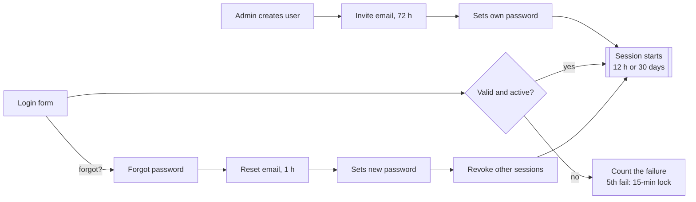

# BariHisab — Authentication & Authorization PRD

> Version 1.0 · Nov 8, 2026 · Author: Rayhan (dev4@awfatech.com)
> Scope: Phase 0 / Week 1 foundation. Login, invite, password reset, sessions, roles & permissions, Super Admin user management.

## Table of Contents

1. [Overview](#1-overview)
2. [Roles & Permissions](#2-roles--permissions)
3. [User Flows](#3-user-flows)
4. [Screens](#4-screens)
5. [Functional Requirements](#5-functional-requirements)
6. [Data Model](#6-data-model)
7. [API Endpoints](#7-api-endpoints)
8. [Security & Non-functional Requirements](#8-security--non-functional-requirements)
9. [Acceptance Criteria, Rollout & Open Questions](#9-acceptance-criteria-rollout--open-questions)

---

## 1. Overview

BariHisab v1 ships an invite-only login system: no public sign-up, two roles (Super Admin, Owner), server-side revocable sessions, and every permission checked on the server by name. This is the Week 1 / Phase 0 foundation that all other modules sit on.

**Goal.** Only invited family members can get in, each sees exactly what their role allows, and the bookkeeper can add, remove and audit access without a developer.

### In scope (v1)

- Login with username or email + password, "Remember me" (30 days)
- Invite flow: Admin creates user → email link (72 h) → user sets password
- Forgot / reset password (1 h link)
- Logout, logout from all devices, session list
- Brute-force protection: 5 wrong attempts → 15-minute lock; 10 login requests/min/IP
- Role-based authorization (Super Admin, Owner) with a permission map
- Super Admin dashboard (auth-relevant parts) and User management screen
- First Super Admin bootstrap by seed script
- Auth audit log (logins, failures, role changes, deactivations)

### Out of scope (later)

- 2FA / TOTP for Super Admin (P3)
- Accountant and Viewer roles (P3 — only new rows in the permission map)
- Social login, SMS OTP, public sign-up, multi-house switching
- Bearer tokens for a mobile app (API stays ready for it)

### Assumed stack

Next.js (App Router) + TypeScript, PostgreSQL 16, Better Auth or an own session table, Zod, pg-boss email outbox — as in the main BariHisab PRD. Every rule here holds on Laravel too.

### Success metrics

| Metric | Target |
| --- | --- |
| Invited users who set a password within 72 h | ≥ 90% |
| Login p95 response | < 500 ms |
| Unauthorized API calls that return data | 0 (covered by tests) |
| Accounts locked by mistake per month | ≤ 1 |
| Plaintext passwords or tokens stored | 0 |

---

## 2. Roles & Permissions

Code checks permissions, never role names: `can(user, 'user.create')`. Roles map to permissions in one file, so adding Accountant or Viewer later is a config change, not a code change.

### Roles

| Role | Who | Phase |
| --- | --- | --- |
| `SUPER_ADMIN` | Family bookkeeper, usually also an owner | P1 |
| `OWNER` | Co-owner of the house | P1 |
| `ACCOUNTANT` | Assistant bookkeeper — enter income/expense only | P3 |
| `VIEWER` | Family member without a share — reports only | P3 |

System role (permissions) and ownership (owner profile + share %) live in separate tables. One person can be `SUPER_ADMIN` and an owner at once. `house_responsibility` ("handles electricity bill") is a label, not a role.

### Permission map (v1)

| Permission key | Action | Super Admin | Owner |
| --- | --- | --- | --- |
| `user.create` | Create user + send invite | ✓ | ✗ |
| `user.update` | Edit any user, change role | ✓ | ✗ |
| `user.deactivate` | Deactivate / reactivate user | ✓ | ✗ |
| `user.invite.resend` | Resend or revoke invite | ✓ | ✗ |
| `user.list` | See user list with status, last login | ✓ | ✗ |
| `user.session.revoke` | Force-logout another user | ✓ | ✗ |
| `profile.update.self` | Edit own name, phone, birthday, profession, photo, language | ✓ | ✓ |
| `profile.password.self` | Change own password | ✓ | ✓ |
| `profile.identity.self` | Change own email / username | ✓ | ✗ (ask Admin) |
| `session.manage.self` | See own sessions, log out all devices | ✓ | ✓ |
| `audit.view.all` | Full audit log incl. auth events | ✓ | ✗ |
| `audit.view.financial` | Financial changes in audit log | ✓ | ✓ |
| `dashboard.admin` | Admin blocks on Home (fund, reconciliation, queues) | ✓ | ✗ |
| `settings.manage` | House settings, categories, email schedule | ✓ | ✗ |

Financial permissions (`period.close`, `payout.create`, `request.approve` …) follow the same pattern and are listed in the main PRD.

Example `lib/permissions.ts`:

```ts
export const ROLE_PERMISSIONS = {
  SUPER_ADMIN: [
    'user.create', 'user.update', 'user.deactivate', 'user.invite.resend',
    'user.list', 'user.session.revoke', 'profile.update.self',
    'profile.password.self', 'profile.identity.self', 'session.manage.self',
    'audit.view.all', 'audit.view.financial', 'dashboard.admin', 'settings.manage',
  ],
  OWNER: [
    'profile.update.self', 'profile.password.self', 'session.manage.self',
    'audit.view.financial',
  ],
} as const;

export function can(user: { roles: Role[] }, permission: Permission): boolean {
  return user.roles.some((r) => ROLE_PERMISSIONS[r]?.includes(permission));
}
```

### Hard rules

1. At least one active `SUPER_ADMIN` must always exist. The last one cannot be deactivated or demoted — API returns `409 LAST_SUPER_ADMIN`.
2. Users are never deleted, only deactivated. Their financial history stays.
3. A deactivated user cannot log in, all their sessions are revoked at once, and they receive no email.
4. Hiding a button is never the check. Every endpoint and server action calls `can()` first.
5. A Super Admin cannot remove their own `SUPER_ADMIN` role.

---

## 3. User Flows

Three doors lead to a session: accepting an invite, logging in, or resetting a password. All three end with a fresh server-side session.



A failed login never says why; the 5th failure locks the account for 15 minutes.

### 3.1 Invite (first login)

1. Super Admin opens User management → New user → fills the form → Save.
2. Server creates `users` row (status `INVITED`, no password), role row, `INVITE` token (72 h), outbox email, audit `auth.invite.sent`.
3. User opens `/invite/:token` → server checks hash, expiry, not used, not revoked.
4. User sets password (+ language) → password hashed, token marked used, status `ACTIVE`, session created, redirect to Home.

### 3.2 Login

1. User enters username or email + password (+ Remember me).
2. Server: rate limit → find user (case-insensitive) → check `locked_until` → verify hash → check status `ACTIVE`.
3. Success: reset fail count, rotate session, set cookie, update `last_login_at`, audit `auth.login.success`.
4. Failure: fail count +1, at 5 set `locked_until = now + 15 min`, audit `auth.login.failed`, generic error.

### 3.3 Forgot / reset password

1. User enters email on `/forgot` → always "If that email has an account, a link is on its way."
2. If the account is `ACTIVE`: revoke older reset tokens, create `RESET` token (1 h), queue email.
3. User opens `/reset/:token`, sets new password → token used, all sessions revoked, fail count cleared, "password changed" email, new session.

### 3.4 Logout & session life

- Logout: revoke current session row, clear cookie, audit `auth.logout`.
- Logout all: revoke every session of the user.
- Each request: read cookie → hash → load session → reject if revoked, expired or user not `ACTIVE` → slide idle timer.
- Admin deactivates a user or changes their role → that user's sessions are revoked at once.

---

## 4. Screens

Seven screens, all bilingual (বাংলা default, English toggle), built with the BariHisab design system: split layout on auth pages, 0 radius, 44px targets, ink primary button with trailing arrow.

| # | Screen | Route | Who | Key elements |
| --- | --- | --- | --- | --- |
| A1 | Login | `/login` | Public | Username or email, password, "Remember me for 30 days", Forgot password link, language toggle, error strip |
| A2 | Forgot password | `/forgot` | Public | Email field, "Send reset link"; always shows the same success message |
| A3 | Reset password | `/reset/:token` | Token holder | New + repeat password, live checks (8+ chars, match), expired-link state |
| A4 | Accept invite | `/invite/:token` | Token holder | "Welcome, {name}", username shown read-only, new + repeat password, language pick, expiry kicker ("expires in 71 h") |
| A5 | Super Admin dashboard | `/` | SUPER_ADMIN | Owner view + Bookkeeper's desk: fund, reconciliation, pending requests, open complaints, close-month reminder, pending invites count |
| A6 | User management | `/admin/users` | SUPER_ADMIN | List, search, filters, New user drawer, resend/revoke invite, deactivate, force logout |
| A7 | Profile & security | `/me` | Everyone | Profile fields, change password, active sessions, log out all devices |

### A1 Login — states

- Empty → submit disabled until both fields have text
- Wrong credentials → one generic message: "Username/email or password is wrong." Never say which one.
- 3rd wrong attempt → add "2 attempts left before a 15-minute lock."
- Locked → "Too many attempts. Try again in 15 minutes or reset your password."
- Deactivated or invited-but-not-set → the same generic message (no account status leak)
- Success → redirect to `?next=` if it is a safe internal path, else `/`

### A4 Accept invite — states

- Valid → form
- Expired (> 72 h) → "This invite has expired. Ask {admin name} to send a new one." No form.
- Used or revoked → "This invite was already used." + Log in button
- Already logged in as someone else → ask to log out first

### A6 User management — details

- Table columns: Person (avatar, name, username), Role, House responsibility, Status tag (Invited / Active / Inactive), Last login, row actions
- Filters: search (name, username, email, phone), role, status
- New user drawer (right side, 540px): Username\*, Email\*, First / Last / Surname, Birthday, Profession, Phone, WhatsApp (or "same as phone"), System role\*, House responsibility, Language. Save sends the invite.
- Row actions: Edit, Resend invite (Invited only), Revoke invite, Deactivate / Reactivate (confirm dialog + reason), Log out everywhere
- Last active Super Admin: Deactivate and role change disabled with a tooltip

### Validation

| Field | Rule |
| --- | --- |
| Username | 3–30 chars, `a-z 0-9 _ .`, lowercase, unique (case-insensitive) |
| Email | Valid format, unique (case-insensitive) |
| Password | ≥ 8 chars, ≤ 128, not equal to username/email, not in a top-10k breached list |
| Phone / WhatsApp | Bangladesh format `01XXXXXXXXX` or `+8801XXXXXXXXX` |
| Role | One of the enabled roles |

---

## 5. Functional Requirements

P1 = must ship in Week 1; P2 = Phase 2; P3 = later.

| ID | Requirement | Priority |
| --- | --- | --- |
| AUTH-01 | Log in with username **or** email (case-insensitive) + password | P1 |
| AUTH-02 | "Remember me" keeps the session 30 days; without it the session ends after 12 h idle or browser close | P1 |
| AUTH-03 | 5 wrong passwords in a row on one account → account locked 15 min; counter resets on success | P1 |
| AUTH-04 | Rate limit `/auth/*`: 10 requests/min per IP, 5/min per account identifier → `429` | P1 |
| AUTH-05 | Logout ends the current session; "Log out all devices" ends every session of the user | P1 |
| AUTH-06 | Password change or reset revokes all other sessions and sends a "password changed" email | P1 |
| AUTH-07 | Session list on `/me`: device, browser, IP city, last active; revoke one | P2 |
| AUTH-08 | 2FA (TOTP) optional for Super Admin, with 10 backup codes | P3 |
| INV-01 | No public sign-up. Only `user.create` can create accounts | P1 |
| INV-02 | Creating a user sets status `INVITED` and queues an invite email with a single-use link valid 72 h | P1 |
| INV-03 | Accept invite: user sets password (+ language); status → `ACTIVE`; user is logged in | P1 |
| INV-04 | Resend invite revokes the old token and issues a new 72 h token | P1 |
| INV-05 | Revoke invite makes the link dead at once | P1 |
| INV-06 | Expired invites show on the Admin dashboard as "Invites waiting" | P2 |
| PWD-01 | Forgot password: same response whether or not the email exists | P1 |
| PWD-02 | Reset link single-use, valid 1 h; a new request voids older links | P1 |
| PWD-03 | Max 3 reset emails per account per hour | P1 |
| PWD-04 | Change password on `/me` needs the current password | P1 |
| USR-01 | Create / edit user with the fields in Screens › A6 | P1 |
| USR-02 | List with search, role and status filters, last login | P1 |
| USR-03 | Deactivate / reactivate with a required reason; deactivate revokes sessions and pending tokens | P1 |
| USR-04 | Change role; guarded by the last-Super-Admin rule | P1 |
| USR-05 | Admin force-logout of a user | P1 |
| USR-06 | Owner can change own profile but not email/username | P1 |
| RBAC-01 | Central `can(user, permission, resource?)` used by every route handler, server action and page loader | P1 |
| RBAC-02 | Role → permission map in one file (`lib/permissions.ts`) | P1 |
| RBAC-03 | Unauthenticated request → `401` (API) or redirect to `/login?next=` (page) | P1 |
| RBAC-04 | Authenticated but not allowed → `403` (API) or a "You don't have access" page | P1 |
| RBAC-05 | UI hides actions the user can't do, using the same `can()` sent to the client | P1 |
| RBAC-06 | Every query is scoped by `property_id` (ready for multi-house) | P1 |
| BOOT-01 | Seed script creates the first Super Admin from env (`SEED_ADMIN_EMAIL`, `SEED_ADMIN_USERNAME`) and prints / emails a one-time invite link | P1 |
| BOOT-02 | Seed is idempotent: running it again does nothing if a Super Admin exists | P1 |
| AUD-01 | Log auth events: login success/fail, lock, logout, logout-all, password change/reset, invite sent/accepted/revoked, role change, deactivate/reactivate, force-logout | P1 |
| AUD-02 | Audit rows are append-only (UPDATE/DELETE revoked at DB level) and carry actor, IP, user agent, before/after | P1 |
| EML-01 | Invite, reset and "password changed" emails go through the outbox, in the user's language | P1 |

---

## 6. Data Model

Six tables carry auth. Tokens and session ids are stored only as SHA-256 hashes; the raw value lives only in the email link or the cookie.

| Table | Key columns | Notes |
| --- | --- | --- |
| `users` | id (uuid), username (citext unique), email (citext unique), password_hash (nullable until invite accepted), first_name, last_name, surname, birthday, profession, phone, whatsapp, whatsapp_same_as_phone, house_responsibility, locale (`bn`/`en`), status (`INVITED`/`ACTIVE`/`INACTIVE`), failed_login_count, locked_until, last_login_at, password_changed_at, created_by, created_at, updated_at | No financial data |
| `user_roles` | user_id, property_id (nullable = global), role (`SUPER_ADMIN`/`OWNER`/`ACCOUNTANT`/`VIEWER`), granted_by, granted_at | PK (user_id, property_id, role); one person can hold several roles |
| `sessions` | id, user_id, token_hash (unique), remember (bool), ip, user_agent, created_at, last_seen_at, expires_at, revoked_at, revoked_reason | Server-side, revocable; look up by hash on every request |
| `auth_tokens` | id, user_id, type (`INVITE`/`RESET`), token_hash (unique), expires_at, used_at, revoked_at, created_by, created_at | Single-use; issuing a new one of the same type revokes the old |
| `audit_logs` | id, actor_id, action, entity_type, entity_id, before jsonb, after jsonb, reason, ip, user_agent, created_at | INSERT-only; auth actions use `auth.*` names |
| `email_outbox` | id, to_user_id, template (`INVITE`/`RESET`/`PASSWORD_CHANGED`), payload jsonb, status, attempts, last_error, sent_at, dedupe_key | Worker sends; API never emails directly |

### Constraints & indexes

- `users.username` check: `^[a-z0-9_.]{3,30}$`
- Partial index `sessions(user_id) WHERE revoked_at IS NULL`
- Partial index `auth_tokens(user_id, type) WHERE used_at IS NULL AND revoked_at IS NULL`
- DB trigger or service check: cannot remove the last active `SUPER_ADMIN` row
- `REVOKE UPDATE, DELETE ON audit_logs` from the app role

### Audit action names

`auth.login.success` · `auth.login.failed` · `auth.locked` · `auth.logout` · `auth.logout_all` · `auth.password.changed` · `auth.password.reset` · `auth.invite.sent` · `auth.invite.accepted` · `auth.invite.revoked` · `user.created` · `user.updated` · `user.role.changed` · `user.deactivated` · `user.reactivated` · `user.sessions.revoked`

---

## 7. API Endpoints

REST under `/api/v1`, JSON only. Web auth uses an httpOnly, Secure, SameSite=Lax cookie `bh_session`; every state-changing request also sends an `X-CSRF-Token` header. Errors use one shape:

```json
{ "error": { "code": "INVALID_CREDENTIALS", "message": "..." } }
```

| Method | Path | Permission | Body → Response |
| --- | --- | --- | --- |
| POST | `/auth/login` | Public | `{ identifier, password, remember }` → `200 { user, roles, permissions }` + cookie |
| POST | `/auth/logout` | Logged in | → `204`, cookie cleared |
| POST | `/auth/logout-all` | Logged in | → `204`, all sessions revoked |
| GET | `/auth/session` | Logged in | → `200 { user, roles, permissions, csrfToken }` |
| POST | `/auth/forgot` | Public | `{ email }` → always `202` |
| GET | `/auth/reset/:token` | Public | → `200 { valid: true }` or `410 TOKEN_EXPIRED` |
| POST | `/auth/reset` | Public (token) | `{ token, password }` → `204`, other sessions revoked |
| GET | `/auth/invite/:token` | Public | → `200 { firstName, username, invitedBy, expiresAt }` or `410` |
| POST | `/auth/accept-invite` | Public (token) | `{ token, password, locale }` → `200 { user }` + cookie |
| GET | `/me` | Logged in | → `200 { profile }` |
| PATCH | `/me` | `profile.update.self` | `{ firstName, phone, locale, ... }` → `200` |
| POST | `/me/password` | `profile.password.self` | `{ currentPassword, newPassword }` → `204` |
| GET | `/me/sessions` | `session.manage.self` | → `200 [ { id, device, ip, lastSeenAt, current } ]` |
| DELETE | `/me/sessions/:id` | `session.manage.self` | → `204` |
| GET | `/users` | `user.list` | `?q=&role=&status=&cursor=&limit=50` → `200 { items, nextCursor }` |
| POST | `/users` | `user.create` | `{ username, email, names..., role, locale }` → `201 { user }` + invite queued |
| GET | `/users/:id` | `user.list` | → `200 { user, roles, lastLoginAt }` |
| PATCH | `/users/:id` | `user.update` | fields → `200` |
| PUT | `/users/:id/roles` | `user.update` | `{ roles: ["OWNER"] }` → `200` or `409 LAST_SUPER_ADMIN` |
| POST | `/users/:id/deactivate` | `user.deactivate` | `{ reason }` → `200` or `409 LAST_SUPER_ADMIN` |
| POST | `/users/:id/reactivate` | `user.deactivate` | `{ reason }` → `200` |
| POST | `/users/:id/resend-invite` | `user.invite.resend` | → `202` |
| POST | `/users/:id/revoke-invite` | `user.invite.resend` | → `204` |
| POST | `/users/:id/revoke-sessions` | `user.session.revoke` | → `204` |
| GET | `/audit?category=auth` | `audit.view.all` | → `200 { items, nextCursor }` |

### Error codes

| HTTP | Code | When |
| --- | --- | --- |
| 401 | `UNAUTHENTICATED` | No or expired session |
| 401 | `INVALID_CREDENTIALS` | Wrong identifier/password, inactive or not-yet-activated account (same message for all) |
| 423 | `ACCOUNT_LOCKED` | Locked after 5 failures; `details.retryAfter` in seconds |
| 429 | `RATE_LIMITED` | Too many requests; `Retry-After` header |
| 403 | `FORBIDDEN` | Logged in but missing the permission |
| 403 | `CSRF_INVALID` | Missing or wrong CSRF token |
| 410 | `TOKEN_EXPIRED` / `TOKEN_USED` | Invite or reset link no longer valid |
| 409 | `LAST_SUPER_ADMIN` | Would leave zero active Super Admins |
| 409 | `USERNAME_TAKEN` / `EMAIL_TAKEN` | Duplicate on create/update |
| 422 | `VALIDATION_FAILED` | Zod errors in `details.fields` |

---

## 8. Security & Non-functional Requirements

This app holds family money records, so security beats convenience in every trade-off below.

| Area | Requirement |
| --- | --- |
| Password hashing | Argon2id (memory 19 MiB, iterations 2, parallelism 1) or bcrypt cost 12; rehash on login if parameters change |
| Tokens | 32 random bytes (`crypto.randomBytes`), base64url in the link, SHA-256 hash in DB; constant-time compare |
| Session cookie | `bh_session`, httpOnly, Secure, SameSite=Lax, Path=/; rotate the session id on login and on privilege change |
| Session lifetime | 12 h idle / 7 days absolute without "Remember me"; 30 days with it; `last_seen_at` updated at most once per 5 min |
| CSRF | Double-submit or synchronizer token on every POST/PATCH/PUT/DELETE; also check `Origin` header |
| Brute force | 5 fails → 15 min lock per account; 10 req/min per IP on `/auth/*`; small fixed delay on failed login |
| Enumeration | Login, forgot and invite errors never reveal whether an account exists |
| Open redirect | `next` param accepted only if it starts with `/` and not `//` |
| Transport | HTTPS only, HSTS 1 year, secure headers (CSP, X-Frame-Options DENY, Referrer-Policy strict-origin) |
| Authorization | `can()` on every route handler, server action and page loader; middleware only checks "logged in", never permissions alone |
| Tenant scope | Every query filtered by `property_id`; ready for Postgres RLS later |
| Secrets | Session secret, DB URL, mail API key in env only; never in the client bundle |
| Privacy | `noindex` on all pages; personal fields (birthday, phone) only for logged-in members |
| Logging | No passwords, tokens or full cookies in logs or Sentry; mask emails in error logs |
| Performance | Login API p95 < 500 ms; session lookup < 20 ms (indexed hash) |
| Localization | Every auth string in `bn` and `en`; emails in the user's `locale` |
| Accessibility | Real `<label>` on every field, errors linked with `aria-describedby`, focus moves to the error strip on failure, 44px targets |
| Testing | Unit tests for `can()` and token logic; integration tests for every endpoint's 401/403 path; CI blocks deploy on failure |

---

## 9. Acceptance Criteria, Rollout & Open Questions

Auth is done when every box below is ticked on staging with real email delivery.

### Acceptance criteria

- [ ] Seed creates exactly one Super Admin; running it twice changes nothing
- [ ] Super Admin creates an Owner → invite email arrives in the right language within 1 min
- [ ] Invite link works once; a second use shows "already used"; after 72 h shows "expired"
- [ ] Resend invite kills the old link
- [ ] Login works with username and with email, any letter case
- [ ] 5 wrong passwords lock the account for 15 min; correct password during lock still fails
- [ ] Forgot password gives the same message for a real and a fake email
- [ ] Reset link works once, dies after 1 h, and logs out all other devices
- [ ] "Remember me" survives a browser restart; without it the session ends after 12 h idle
- [ ] Log out all devices ends sessions on a second browser at once
- [ ] Deactivated user is logged out everywhere and cannot log in
- [ ] Last Super Admin cannot be deactivated or demoted (UI disabled + API `409`)
- [ ] Owner calling any admin endpoint directly gets `403`; no admin data in the response
- [ ] Owner never sees admin nav items, buttons or dashboard blocks
- [ ] Every auth event appears in the audit log with IP and user agent
- [ ] No password, token or cookie value appears in logs or Sentry
- [ ] All auth screens work at 360px width and in বাংলা and English

### Rollout (Week 1)

1. **Day 1** — Schema migration (`users`, `user_roles`, `sessions`, `auth_tokens`, `audit_logs`, `email_outbox`), seed script, `lib/permissions.ts`
2. **Day 2** — Login, logout, session middleware, CSRF, rate limit, lockout
3. **Day 3** — Invite + accept, forgot + reset, email outbox worker and templates
4. **Day 4** — User management screen and APIs, deactivate, role change, last-admin guard
5. **Day 5** — Profile & security page, role-aware dashboard shell, audit entries, tests, staging check

### Open questions

- [ ] Better Auth library or own session table? Library is faster; own table gives full control of the lock and audit rules.
- [ ] Which email provider (Resend, Postmark, Amazon SES) and sender domain?
- [ ] Should Owners also be allowed to log in with phone number later?
- [ ] Lock rule: unlock automatically after 15 min only, or also let Super Admin unlock manually?
- [ ] Keep sessions of a user whose role changes from Super Admin to Owner, or force re-login?