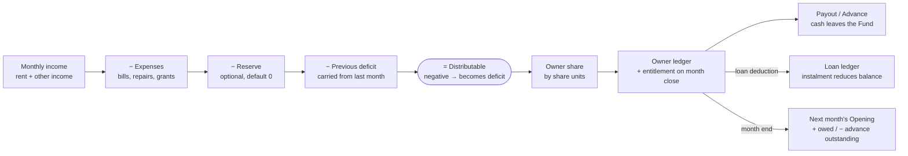
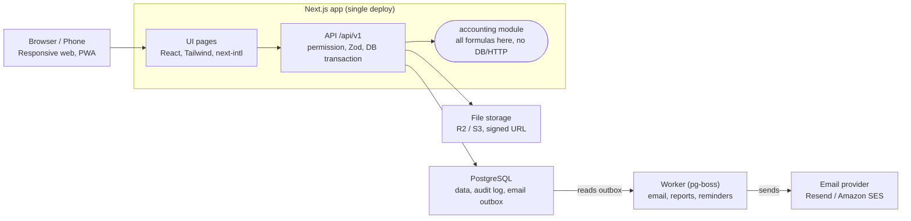
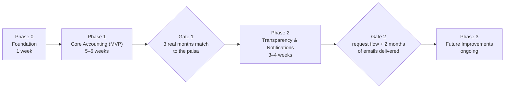

# BariHisab — House Rental & Co-owner Accounting

> **Product Requirements Document (PRD) v1.0** · English edition · 22 Oct 2026
> Author: Rayhan (dev4@awfatech.com)

BariHisab is a web app that keeps one house's rental income, expenses, owner distributions, payments, advances/loans and monthly/yearly accounts in one transparent place. v1 serves a single house, but the data model supports multiple houses from day one.

---

## Table of Contents

1. [Product Summary](#1-product-summary)
2. [Goals, Non-Goals & Success Metrics](#2-goals-non-goals--success-metrics)
3. [Key Product Decisions & Assumptions](#3-key-product-decisions--assumptions)
4. [Users, Roles & Permissions](#4-users-roles--permissions)
5. [Core Accounting Model & Calculation Rules](#5-core-accounting-model--calculation-rules)
6. [Functional Requirements (by Module)](#6-functional-requirements-by-module)
7. [Key User Flows](#7-key-user-flows)
8. [Screens & UI Specification](#8-screens--ui-specification)
9. [Data Model (PostgreSQL)](#9-data-model-postgresql)
10. [API Specification](#10-api-specification-rest-apiv1)
11. [Email Notification Specification](#11-email-notification-specification)
12. [Non-Functional Requirements](#12-non-functional-requirements)
13. [Tech Stack & Architecture](#13-tech-stack--architecture)
14. [Release Plan & Acceptance Criteria](#14-release-plan--acceptance-criteria)
15. [Testing Strategy & Calculation Test Cases](#15-testing-strategy--calculation-test-cases)
16. [Future Extensions, Open Questions & Glossary](#16-future-extensions-open-questions--glossary)

---

## 1. Product Summary

| Item | Detail |
| --- | --- |
| Product | BariHisab — House Rental Income, Expense & Owner Distribution Manager |
| Document | Product Requirements Document (PRD) v1.0 |
| Platform | Responsive web app (mobile-browser first), later PWA / mobile app |
| Primary users | Super Admin (bookkeeper), House Owner / Member |
| Currency & timezone | BDT (৳), Asia/Dhaka |
| Language | Bangla + English (UI toggle) |

### Problem

- In a house with several owners, the monthly rent, expenses and shares are kept on paper or in separate notebooks, which leads to mistakes and misunderstandings.
- Nobody can see in one place who got how much, who is still owed, and who took extra money or an advance.
- There is no proof of expenses (bills/receipts) and no history of changes to old accounts, so disputes are hard to settle.

### Vision

A simple, trustworthy "family ledger": the Super Admin enters the data, the system automatically calculates each owner's entitlement, and every owner can view any month's accounts from their phone. Every money movement has a history; nothing is ever silently deleted.

### Design Principles

1. **Correct accounting comes first** — accounting rules matter more than UI or email.
2. **Entitlement and Payment are always separate** — they are never merged.
3. **Never delete, always reverse** — financial records are corrected with reversing entries, not removed.
4. **Simple UI** — few pages, big numbers, clear Bangla labels, usable one-handed on mobile.
5. **Future-ready** — `property_id` on every table, permission-based roles, pluggable notification channels.

---

## 2. Goals, Non-Goals & Success Metrics

The v1 goal: a month's accounts can be entered and closed in under 10 minutes, and every owner can see their own entitlement, amount received and balance by themselves.

### Goals

1. Monthly income, expenses and distributable amount are calculated automatically.
2. Each owner's entitlement is determined exactly according to their ownership percentage.
3. Every payment, advance, loan and extra payout is recorded as its own type, and balances are always correct.
4. All owners see the same information (transparency), but only authorised people can enter data (security).
5. Monthly reports and important events are emailed automatically (Phase 2).

### Non-Goals (not in v1)

- Tenant portal, online rent collection (bKash/Nagad gateway).
- Full double-entry accounting software (Tally/QuickBooks-style).
- Multi-house UI (data model ready; UI in Phase 3).
- SMS / WhatsApp notifications, native mobile app.
- Tax / income-tax calculation.

### Success Metrics

| Metric | Target |
| --- | --- |
| Admin time to enter + close a month | ≤ 10 minutes |
| Arithmetic mismatches (sum of shares ≠ distributable) | 0 |
| Owners logging in at least once a month | ≥ 80% |
| Time to answer "how much am I owed?" on a phone | ≤ 2 clicks / 10 seconds |
| Unresolved account complaints older than 7 days | 0 |
| Monthly email delivery success (Phase 2) | ≥ 97% |

---

## 3. Key Product Decisions & Assumptions

The following defaults answer the open questions in the original spec. Discuss them with the family; most can be changed in Settings.

| # | Decision | Reason / Explanation |
| --- | --- | --- |
| D1 | v1 is one house, but every financial table has `property_id` | Adding more houses later needs no migration |
| D2 | Distribution is by ownership percentage; equal split = everyone has the same % | One rule covers both cases |
| D3 | Ownership % is effective-dated; total is always 100% | Old months stay correct after inheritance or a share sale |
| D4 | Only the Super Admin enters data (optional Accountant role later); owners view, request and complain | Simple and safe model |
| D5 | The Super Admin can also be an owner: system role (permissions) and ownership (Owner profile + %) live in separate tables | One person can hold both roles |
| D6 | "Role / Responsibility" is split into `system_role` (permissions) and `house_responsibility` (a label such as "handles electricity bill") | They are different things |
| D7 | One Phone field + "This is also WhatsApp" checkbox; a separate WhatsApp field appears only if different | Shorter form |
| D8 | Accounts are monthly periods: Open → Closed (Locked) | Numbers of a closed month never change silently |
| D9 | Financial records are never hard-deleted; mistakes are Voided/Reversed with a reason; every change goes to the Audit Log | History is visible in disputes |
| D10 | The house's money sits in a "House Fund" (Cash / Bank / Mobile-wallet accounts); income increases it, expenses and payments decrease it | Report figures can be reconciled with real cash |
| D11 | Income is booked to the month it belongs to (period); the collection date is a separate field | Late rent still lands in the right month |
| D12 | All money is stored as integer paisa; shares are rounded with the Largest Remainder method | Shares always add up exactly |
| D13 | If expenses exceed income, the deficit is carried forward and deducted from next month's distributable | Nobody has to pay cash in |
| D14 | Optional "Reserve Holdback": a fixed amount or % kept back before distribution (default 0) | Saves for big repairs |
| D15 | Transparency: all owners see everyone's entitlement, payments and advances; complaints are visible to all by default, with an "Admin only" option | Sensitive matters can stay private |
| D16 | When an extra-money request is submitted only the Admin is notified; once disbursed, all owners are emailed | Avoids unnecessary anxiety |
| D17 | Monthly email = short summary + own account + dashboard link; full detail on the dashboard | Emails stay short and safe |

---

## 4. Users, Roles & Permissions

v1 has two system roles — **Super Admin** and **Owner** — and code checks permissions by name (not by role name), so adding Accountant or Viewer later is easy.

### Personas

| Role | Who | Main work | Phase |
| --- | --- | --- | --- |
| Super Admin | Family bookkeeper (usually also an owner) | Data entry, payments, approvals, month close, user management | 1 |
| Owner / Member | Co-owner of the house | View accounts, requests, complaints, receive notices | 1 |
| Accountant | Assistant bookkeeper / caretaker | Enter income/expenses; no approvals or user management | 3 |
| Viewer | Family member without a share | View reports only | 3 |

### Permission Matrix (v1)

| Action | Super Admin | Owner |
| --- | --- | --- |
| Create / edit / deactivate users | ✓ | ✗ |
| Edit own profile (name, phone, birthday, profession, password) | ✓ | ✓ |
| Change own Email / Username | ✓ | ✗ (ask Admin) |
| Set / change ownership % | ✓ | ✗ |
| Enter / edit (Open month) / Void income & expenses | ✓ | ✗ |
| View income, expenses and bill images | ✓ | ✓ |
| Close / reopen a month | ✓ | ✗ |
| Record payment to an owner | ✓ | ✗ |
| View every owner's entitlement, payments and balance | ✓ | ✓ |
| Request extra money / advance / loan | ✓ (for self too) | ✓ |
| Approve / reject requests | ✓ (self-approval is tagged "Self-approved" and emailed to everyone) | ✗ |
| Submit and comment on complaints/reports | ✓ | ✓ |
| Change complaint status / write resolution | ✓ | ✗ (can withdraw own complaint) |
| Create notices and send email | ✓ | ✗ |
| View reports and download PDF/Excel | ✓ | ✓ |
| View Audit Log | ✓ | ✓ (financial changes only) |
| Settings (house, expense categories, email schedule) | ✓ | ✗ |

### Important Rules

- At least one active Super Admin must always exist; the last Super Admin cannot be deactivated.
- Users are never deleted, only deactivated — their financial history remains.
- Permissions are always checked on the server; hiding buttons in the UI is not enough.

---

## 5. Core Accounting Model & Calculation Rules

The whole app rests on three ledgers: the **monthly house ledger** (income–expense–distributable), **each owner's ledger** (entitlement vs. payments) and the **loan ledger**. They never mix; they connect only through specific entries.



The top row is the house ledger, the middle is the owner ledger; cash leaves only at the Payout/Advance step, and loans live in a separate ledger.

### 5.1 Monthly Period (Accounting Period)

- One `period` per month (e.g. 2026-10), status `OPEN` or `CLOSED`.
- In an Open month, entitlements are shown live as a "Preview"; **Close** creates the Entitlement entries and locks the month.
- Several months can be Open at once, but they must be closed in order (October cannot close before September).
- Reopen: only the most recent Closed month, a reason is required, all owners are notified; on re-close the old Entitlements are reversed and new ones created.
- Older mistakes (more than one month back): no reopen — instead an "Adjustment" entry in the current Open month with `reference_period` = the old month.
- Rent for a Closed month arriving late: entered in the current month as "Arrear Rent" with `reference_period`.

### 5.2 Distributable

```text
Net(P)            = Income(P) − Expense(P) − Reserve(P) − DeficitCarried(P−1)
Distributable(P)  = max(0, Net(P))
DeficitCarried(P) = max(0, −Net(P))
```

- Income = rent + other income (e.g. rooftop tower rent), excluding deposits. A tenant's Security Deposit is not income — it will be a separate liability in Phase 3.
- Expense = all expenses of that month that are not marked "paid from Reserve".
- Reserve = per the Settings rule: a fixed amount or a % of (Income − Expense) (only when positive), default 0, overridable per month.

### 5.3 Owner Entitlement & Rounding

- Ownership is stored as **share units** (integers), not %, e.g. 3 equal owners = 1:1:1, the example above = 40:25:15:10:10. This makes a 1/3 split exact. The UI shows %.
- Share changes take effect from the 1st of a month (never mid-month). On close, that month's effective share set is used and saved as a snapshot.

```text
Entitlement(i, P) = Distributable(P) × u_i / Σ u_j
```

**Largest Remainder method (in paisa):** (1) compute each share in paisa and floor it; (2) leftover paisa = Distributable − sum of floors; (3) give one paisa each to those with the largest fractional parts (ties by owner sort order). Example: ৳1,000 among 3 equal owners → ৳333.34, ৳333.33, ৳333.33 = ৳1,000.00. Even if real cash payments are in whole taka, the leftover paisa stays in the balance.

### 5.4 Owner Ledger — the most important rule

Each owner has a running balance. **Positive (+) balance = the house owes them (amount due); negative (−) = they have taken more than their entitlement (advance outstanding).**

| Entry type (`entry_type`) | Effect on balance | Effect on House Fund | When |
| --- | --- | --- | --- |
| ENTITLEMENT | + | none | Automatically on month close |
| PAYOUT (regular payment) | − | − (cash out) | When Admin records a payment |
| ADVANCE | − (balance can go negative) | − | When an approved advance is paid |
| LOAN_DEDUCTION | − | none (money stays in the fund) | When a loan is repaid from entitlement; same amount credited to the loan ledger |
| ADJUSTMENT | + or − | none | Correction for an old month; reason required |
| REVERSAL | opposite of original | opposite of original | When a wrong entry is voided |
| OPENING | + or − | none | Balance brought in when the app starts |

```text
Closing(i, P) = Opening(i, P) + Entitlement(i, P) − Payout(i, P) − Advance(i, P)
                − LoanDeduction(i, P) ± Adjustment(i, P)
```

- **Opening = previous month's Closing** — this is the "balance carried forward from last month".
- Advances need no separate "settlement": if the balance is negative, next month's Entitlement automatically fills it first.
- A PAYOUT can never exceed the positive balance. If the Admin enters more, the system asks: "৳5,000 more than the entitlement — is this an advance or a loan?" and splits the payment into two entries.
- Maximum advance limit in Settings (default: 1× the average entitlement of the last 3 months); exceeding it shows a warning, not a block.

### 5.5 Loan — a separate ledger

- A loan does not affect the owner's entitlement balance; it is a separate `loan` record (amount, date, reason, repayment plan).
- Two ways to repay: (a) cash → House Fund +; (b) deduction from entitlement → LOAN_DEDUCTION (a fixed monthly instalment can be automatic after month close).
- Loan Outstanding = disbursed − cash repaid − deductions. At zero the status becomes `REPAID`. No interest in v1.

### 5.6 Special Grant

A non-refundable extra payment is recorded as a house expense (category "Owner Special Grant", linked to the recipient owner). It therefore reduces the distributable amount for all owners by their shares, so emailing everyone after approval is mandatory.

### 5.7 House Fund & Reconciliation

```text
FundBalance = Σ OwnerBalance + ReserveBalance + OpenPeriodNet − DeficitCarried − LoanOutstanding
```

The dashboard checks this equation and shows a green tick or a red warning. In addition, if the Admin enters the real cash/bank balance at month end, the variance is shown.

### 5.8 Full Example (Owner A, 40% share)

October: income ৳100,000, expenses ৳20,000 → distributable ৳80,000. Same in November.

| Month | Opening | Entitlement | Payout | Advance | Closing | Meaning |
| --- | --- | --- | --- | --- | --- | --- |
| October | ৳0 | ৳32,000 | ৳32,000 | ৳5,000 | −৳5,000 | ৳5,000 advance outstanding |
| November | −৳5,000 | ৳32,000 | ৳20,000 | ৳0 | ৳7,000 | ৳7,000 still owed |

In November they could take at most ৳27,000; they took ৳20,000, so ৳7,000 becomes December's Opening.

---

## 6. Functional Requirements (by Module)

Each requirement ID can become a ticket/task. P1 = Phase 1 (Core), P2 = Phase 2, P3 = Phase 3.

### 6.1 Authentication & Account

| ID | Requirement | Phase |
| --- | --- | --- |
| AUTH-01 | Log in with Username or Email + Password | P1 |
| AUTH-02 | No public sign-up; when Admin creates a user an Invite link is emailed (72-hour expiry), the user sets their own password | P1 |
| AUTH-03 | Forgot password (email reset link, 1-hour expiry) | P1 |
| AUTH-04 | Password at least 8 characters; 5 wrong attempts → 15-minute lock | P1 |
| AUTH-05 | "Remember me" session 30 days; log out from all devices | P1 |
| AUTH-06 | Optional 2FA (TOTP) for Super Admin | P3 |

### 6.2 User Management

| ID | Requirement | Phase |
| --- | --- | --- |
| USR-01 | Create user: Username* (unique, 3–30 chars, a-z 0-9 _ .), Email* (unique), First / Last / Surname, Birthday, Profession, Phone, WhatsApp (or "same"), System Role, House Responsibility | P1 |
| USR-02 | User list: search, role and Active/Inactive filters | P1 |
| USR-03 | Edit user, Deactivate/Reactivate (no delete); deactivated users cannot log in and get no email | P1 |
| USR-04 | Resend invite | P1 |
| USR-05 | Own profile page (photo, phone, password change, language, email preferences) | P1 |
| USR-06 | Birthday greeting email (optional fun feature) | P3 |

### 6.3 Property & Ownership

| ID | Requirement | Phase |
| --- | --- | --- |
| OWN-01 | One Property profile: name, address, list of units/flats (name + monthly rent, optional) | P1 |
| OWN-02 | Add a user as owner: share units + effective month; system shows % | P1 |
| OWN-03 | Share change = new version (effective_from), old kept in history; reason required; no effect on Closed months | P1 |
| OWN-04 | Share history timeline | P1 |
| OWN-05 | Multiple properties and property switcher | P3 |

### 6.4 Income

| ID | Requirement | Phase |
| --- | --- | --- |
| INC-01 | Income entry: period, category (Rent / Arrear Rent / Other), unit (optional), amount, collection date, Fund Account, description, attachment | P1 |
| INC-02 | "Generate this month's rent" — one click drafts entries from every unit's set rent; Admin adjusts amounts and saves | P1 |
| INC-03 | Edit in Open months; Closed months allow only Void/Adjustment; every edit goes to the Audit Log | P1 |
| INC-04 | Unpaid-rent tracking (which unit hasn't paid this month) | P2 |

### 6.5 Expenses

| ID | Requirement | Phase |
| --- | --- | --- |
| EXP-01 | Expense entry: period, category, amount, date, description, payee/vendor, Fund Account, "From Reserve" checkbox, bill image/PDF (max 5 files, ≤ 5 MB each) | P1 |
| EXP-02 | Default categories: Electricity, Gas, Water, Repairs, Cleaning & Maintenance, Guard/Salary, Holding Tax, Owner Special Grant, Other; Admin can add/deactivate | P1 |
| EXP-03 | Expense list: month and category filters, total | P1 |
| EXP-04 | Recurring expense templates (e.g. guard's salary every month) | P2 |

### 6.6 Period Close & Distribution

| ID | Requirement | Phase |
| --- | --- | --- |
| DST-01 | Month preview: income, expenses, Reserve, previous deficit, distributable and each owner's entitlement — live | P1 |
| DST-02 | Close checklist: shares = 100%, previous month Closed, at least 1 income entry (warning if none), confirmation dialog | P1 |
| DST-03 | Close creates ENTITLEMENT entries, saves share snapshot, locks the month, (P2) queues the monthly email | P1 |
| DST-04 | Reopen the latest Closed month (reason required) → Entitlements reversed | P1 |
| DST-05 | Distribution Board: per owner Opening, this month's entitlement, received, advance, current balance, loan outstanding — in one table | P1 |

### 6.7 Payments

| ID | Requirement | Phase |
| --- | --- | --- |
| PAY-01 | Record payment: owner, amount, date, against which month (default: oldest due), method (Cash / Bank / bKash / Nagad), Ref no., note, receipt image | P1 |
| PAY-02 | Multiple partial payments, each a separate record; `recorded_by` automatic | P1 |
| PAY-03 | If more than the entitlement, ask whether the excess is an advance or a loan and split it (5.4) | P1 |
| PAY-04 | Warning if the payment exceeds the House Fund balance | P1 |
| PAY-05 | Payment receipt (PDF) to the owner and email on payment | P2 |
| PAY-06 | Owner "I received the money" confirmation button | P3 |

### 6.8 Advances, Loans & Requests

| ID | Requirement | Phase |
| --- | --- | --- |
| ADV-01 | Admin can directly record an Advance / Loan / Special Grant (reason required) | P1 |
| ADV-02 | Loan ledger: disbursement, repayment (cash/deduction), balance, status; optional monthly instalment | P1 |
| ADV-03 | Owner request form: amount, type (Advance / Loan / Special), reason, needed by, (for loans) repayment plan | P2 |
| ADV-04 | Request states: PENDING → APPROVED / REJECTED / CANCELLED → (APPROVED) DISBURSED; Admin may reduce the amount on approval; rejection requires a reason | P2 |
| ADV-05 | Disburse automatically creates the ADVANCE / LOAN / expense entry, linked to the request | P2 |

### 6.9 Reports

| ID | Requirement | Phase |
| --- | --- | --- |
| RPT-01 | Monthly report: rent, other income, expenses (by category and detail), Reserve, deficit, distributable, each owner's entitlement / received / advance / balance / loan | P1 |
| RPT-02 | Yearly report: 12-month columns, monthly income-expense chart, per-owner yearly entitlement vs. payments | P1 |
| RPT-03 | Owner Statement: all entries and running balance for any date range (like a bank statement) | P1 |
| RPT-04 | Open-month reports labelled "Draft — not final" | P1 |
| RPT-05 | PDF and Excel download | P2 (PDF), P3 (Excel) |

### 6.10 Notices & Complaints

| ID | Requirement | Phase |
| --- | --- | --- |
| NTC-01 | Admin notice: title, body, priority (Normal / Urgent), attachments; publishing emails all active owners; pinned on dashboard; "read" tracking | P2 |
| CMP-01 | Complaint/report: title, description, related month or transaction (link), attachments, visibility (Everyone / Admin only) | P2 |
| CMP-02 | States: OPEN → IN_REVIEW → RESOLVED / REJECTED (+ WITHDRAWN); resolution requires Admin explanation | P2 |
| CMP-03 | Comment thread (everyone can participate) | P2 |
| CMP-04 | Reminder to Admin if a complaint stays open 14 days | P3 |

### 6.11 Audit Log

| ID | Requirement | Phase |
| --- | --- | --- |
| AUD-01 | Every create/update/void/close/reopen/approve records who, when, what (before → after JSON), reason | P1 |
| AUD-02 | Audit Log is append-only (nobody can edit/delete); filterable list | P1 |
| AUD-03 | "History" icon beside every entry; edited entries show a "Corrected" badge | P1 |

### 6.12 Settings

| ID | Requirement | Phase |
| --- | --- | --- |
| SET-01 | Property info, Fund Accounts (Cash / Bank / Wallet), expense categories | P1 |
| SET-02 | Reserve rule (fixed / % / off), advance limit | P1 |
| SET-03 | Monthly email day (default right after month close, or the 5th of each month at 9 am), email template language | P2 |

---

## 7. Key User Flows

The monthly cycle (flow B) is the heart of the app; every other flow revolves around it.

### A. First-time setup (Onboarding Wizard — Super Admin)

1. On deploy, a seed script creates the first Super Admin (email from env); password set on first login.
2. House info: name, address, units and rent (optional).
3. Add Fund Accounts (e.g. "Cash — with bookkeeper", "DBBL account") and opening balances.
4. Add owners: each person's user and share units; cannot continue unless the total is 100%. The Admin can add themself as an owner.
5. Opening balances: what each owner was owed/advanced and any running loans before the app started — as OPENING entries.
6. Choose the first period (starting month) → send Invite emails.

### B. Monthly cycle (Super Admin, target ≤ 10 minutes)

1. At the start of the month a new period opens automatically (or on first entry).
2. When rent is collected: "Generate this month's rent" → adjust amounts/dates → Save.
3. When there is an expense: "+ Expense" → category, amount, bill photo (phone camera).
4. At month end, check the preview on the Distribution page → **Close Month** → checklist → confirm.
5. When paying an owner: **Pay** on their row → amount (default = full balance), method, date → Save.
6. (P2) On the scheduled day everyone receives the monthly report email.

### C. An owner checks their account

1. Log in → big card at the top of the dashboard: "Your current balance ৳6,000" (or "Advance outstanding ৳5,000" in red).
2. Below: this month's entitlement, received, loan outstanding; the house's monthly income-expense summary.
3. "Details" → own Statement; switch month to see any month/year; other owners' columns are visible too.

### D. Extra-money request (P2)

1. Owner: "Request money" → type, amount, reason, needed by → Submit. Status PENDING; Admin gets an email.
2. The owner can cancel while PENDING.
3. Admin sees alongside the request: the owner's current balance, running advance/loan, advance limit, Fund balance.
4. Approve (amount can be reduced) or Reject (reason required). The requester is emailed.
5. When cash is handed over, Admin clicks **Disburse** → ADVANCE / LOAN / Special Grant entry created automatically; now all owners are emailed (D16).

### E. Complaint / objection to an entry (P2)

1. "Raise an objection" next to any entry → complaint form opens with the transaction linked.
2. Visibility "Everyone": all owners get a short email + link; "Admin only": only the Admin.
3. Admin sets IN_REVIEW → corrects entries if needed (Void/Adjustment) → RESOLVED + explanation; the complainant is emailed.

### F. Correcting a wrong entry

1. Open month: edit the entry → before/after values in the Audit Log.
2. Latest Closed month: Reopen (reason) → edit → Close again; everyone gets a summary email of the change.
3. Older months: an Adjustment in the current month (income/expense or a specific owner's ledger) with `reference_period`.

---

## 8. Screens & UI Specification

v1 has 12 screens; mobile uses a bottom navigation bar, desktop a left sidebar. Owners and Admins use the same app; the Admin gets extra buttons and menus.

### 8.1 Navigation

| Role | Bottom Nav (mobile) |
| --- | --- |
| Owner | Home · Accounts (Reports) · Requests · Notices · Profile |
| Super Admin | Home · Entries (income/expense) · [+] quick entry · Distribution · More (Owners, Requests, Reports, Notices, Users, Audit, Settings) |

### 8.2 Screen List

| # | Screen | Route | Who | Contents |
| --- | --- | --- | --- | --- |
| S1 | Login / Forgot / Set Password | `/login`, `/reset`, `/invite/:token` | Everyone | Language toggle, simple form |
| S2 | Home dashboard | `/` | Everyone | Owner: big own-balance card, this month's entitlement/received, house income-expense-distributable, last 5 transactions, pinned notices. Admin: plus Fund balance, Reconciliation tick, pending requests/complaints, "Close the month" reminder |
| S3 | Income & Expenses | `/entries?period=2026-10&type=` | Everyone (edit: Admin) | Month picker, income/expense tabs, category filter, list + total; tap an entry → detail + bill image + history |
| S4 | Entry form (bottom sheet) | modal | Admin | Income / Expense / Payment / Advance / Loan — one component, fields change by type; default date today, default period current Open month |
| S5 | Distribution Board | `/distribution?period=` | Everyone (actions: Admin) | Top: Income − Expense − Reserve − Deficit = Distributable "staircase"; below: owner table (share %, Opening, entitlement, received, advance, balance, loan) + Pay per row; Close / Reopen buttons |
| S6 | Owner list & owner detail | `/owners`, `/owners/:id` | Everyone | Share, current balance, loan; detail shows Statement (RPT-03), share history; Admin: change share |
| S7 | Advances & Loans | `/advances` | Everyone | Running loans (balance, instalment), advance history; Admin: new loan, record repayment |
| S8 | Requests (P2) | `/requests` | Everyone | Owner: own requests + new; Admin: pending queue + Approve/Reject/Disburse |
| S9 | Reports | `/reports/monthly`, `/reports/yearly` | Everyone | Monthly/yearly tabs, month/year picker, charts, owner table, Print / PDF |
| S10 | Notices & Complaints (P2) | `/notices`, `/complaints/:id` | Everyone | Notice feed, complaint list with status badges, comment thread |
| S11 | User management | `/admin/users` | Admin | List, new user, resend invite, deactivate |
| S12 | Settings, Audit Log, Profile | `/admin/settings`, `/audit`, `/me` | Admin / Everyone | Settings (SET-01..03), filterable Audit Log, own profile |

### 8.3 UI Rules

- **Money format:** Bangladeshi lakh–crore grouping (৳১,০০,০০০); Bangla digits when the language is Bangla, ৳100,000 in English. Decimals only shown when there are paisa.
- **Colour meaning:** green = owed/income, red = advance outstanding/deficit, grey = Void. Colour is always paired with a text label (never colour alone).
- **Font:** Hind Siliguri / Noto Sans Bengali; big-number cards at least 28px; touch targets ≥ 44px.
- **Month picker:** the same component on every page; the selected month is in the URL (shareable link). Closed months show a lock icon, Open months a "Draft" badge.
- **Safe actions:** Close, Reopen, Void, share change — confirmation dialog with an impact summary + reason field.
- **Empty state:** every empty page says in one line what to do + a button (e.g. "No income added for this month yet").
- **Accessibility:** WCAG AA contrast, Light/Dark mode, keyboard navigation.

---

## 9. Data Model (PostgreSQL)

Balances are never stored in a column; every balance is computed from transactions (SQL views). This leaves no room for mismatched accounts.

**Common rules (all financial tables):** `id UUID`, `property_id`, `created_at`, `created_by`, `updated_at`; money as `*_paisa BIGINT`; for voids `voided_at`, `voided_by`, `void_reason`, `reverses_id`. Time stored in UTC, displayed in Asia/Dhaka.

### 9.1 Users & Property

| Table | Key fields | Notes |
| --- | --- | --- |
| `users` | username (unique, citext), email (unique, citext), password_hash, first_name, last_name, surname, birthday, profession, phone, whatsapp, whatsapp_same_as_phone, house_responsibility, locale (bn/en), status (INVITED/ACTIVE/INACTIVE), last_login_at | No financial data here |
| `user_roles` | user_id, property_id (nullable = global), role (SUPER_ADMIN / OWNER / ACCOUNTANT / VIEWER) | One person can have several roles |
| `auth_tokens` | user_id, type (INVITE/RESET/SESSION), token_hash, expires_at, used_at | Tokens are always hashed |
| `properties` | name, address, currency ('BDT'), timezone, settings JSONB (reserve_rule, advance_limit, email_day, locale_default) | One row in v1 |
| `units` | property_id, name, default_rent_paisa, is_active | Flats/shops |
| `fund_accounts` | property_id, name, type (CASH/BANK/WALLET), opening_balance_paisa, is_active | Parts of the House Fund |
| `fund_transfers` | from_account_id, to_account_id, amount_paisa, transfer_date, note | e.g. cash → bank deposit |

### 9.2 Ownership & Periods

| Table | Key fields | Notes |
| --- | --- | --- |
| `owners` | property_id, user_id (nullable — for deceased/no-login owners), display_name, sort_order, is_active | The Admin also has a row here |
| `ownership_shares` | owner_id, share_units (INT > 0), effective_from (1st of month), reason | History kept; a month's effective set = each owner's latest effective_from ≤ period |
| `periods` | property_id, month (DATE, 1st), status (OPEN/CLOSED), closed_at, closed_by, reopen_count, snapshot JSONB (income, expense, reserve, deficit_in, deficit_out, distributable, shares used) | UNIQUE(property_id, month) |

### 9.3 Transactions

| Table | Key fields | Notes |
| --- | --- | --- |
| `categories` | property_id, kind (INCOME/EXPENSE), name_bn, name_en, code, is_system, is_active | RENT, ARREAR_RENT, OWNER_GRANT are system categories |
| `house_transactions` | period_id, kind (INCOME/EXPENSE), category_id, unit_id?, amount_paisa (> 0), txn_date, fund_account_id, description, vendor?, from_reserve (bool), reference_period_id?, beneficiary_owner_id?, request_id? | Income and expenses in one table |
| `owner_ledger_entries` | owner_id, period_id, entry_type (OPENING / ENTITLEMENT / PAYOUT / ADVANCE / LOAN_DEDUCTION / ADJUSTMENT / REVERSAL), amount_paisa (signed: + increases amount owed, − decreases), entry_date, fund_account_id?, method?, reference_no?, note, request_id?, loan_id? | The owner ledger (5.4) |
| `loans` | owner_id, principal_paisa, disbursed_on, fund_account_id, reason, installment_paisa?, status (ACTIVE/REPAID/WRITTEN_OFF), request_id? | |
| `loan_movements` | loan_id, type (DISBURSE / REPAY_CASH / REPAY_DEDUCTION / REVERSAL), amount_paisa, movement_date, fund_account_id?, owner_ledger_entry_id? | A deduction creates linked rows in both tables |

### 9.4 Requests, Notices, Complaints & System

| Table | Key fields | Notes |
| --- | --- | --- |
| `money_requests` | owner_id, type (ADVANCE/LOAN/GRANT), amount_requested_paisa, amount_approved_paisa?, reason, needed_by, repayment_plan?, status (PENDING/APPROVED/REJECTED/CANCELLED/DISBURSED), decided_by, decided_at, decision_note | |
| `notices` | title, body (markdown), priority (NORMAL/URGENT), is_pinned, published_at, created_by | |
| `notice_reads` | notice_id, user_id, read_at | PK(notice_id, user_id) |
| `complaints` | created_by, title, body, period_id?, related_type?, related_id?, visibility (ALL/ADMIN), status (OPEN/IN_REVIEW/RESOLVED/REJECTED/WITHDRAWN), resolution_note, resolved_by, resolved_at | |
| `complaint_comments` | complaint_id, author_id, body | |
| `attachments` | entity_type, entity_id, storage_key, file_name, mime, size_bytes, uploaded_by | Bills, receipts, complaint evidence |
| `audit_logs` | actor_id, action, entity_type, entity_id, before JSONB, after JSONB, reason, ip, user_agent, created_at | INSERT-only (UPDATE/DELETE revoked at DB level) |
| `email_outbox` | to_user_id, template, payload JSONB, status (QUEUED/SENT/FAILED), attempts, last_error, sent_at, provider_message_id, dedupe_key | Outbox pattern; dedupe_key prevents duplicates |

### 9.5 Derived Views & Constraints

- `v_owner_balance` = sum of non-voided `owner_ledger_entries.amount_paisa` per owner (up to a date or period).
- `v_period_summary` = income, expenses, reserve, distributable (live for Open months, from snapshot for Closed).
- `v_fund_balance` = opening + income − expenses − PAYOUT − ADVANCE − loans disbursed + cash repaid ± transfers, per account.
- DB level: trigger blocking INSERT/UPDATE on rows of a Closed period (except REVERSAL); `CHECK(amount_paisa > 0)` on house_transactions; `ON DELETE RESTRICT` on all FKs.
- Indexes: (property_id, period_id), (owner_id, entry_date), (status) on requests/complaints.

---

## 10. API Specification (REST, `/api/v1`)

All endpoints are JSON; money is always integer paisa; dates ISO (`2026-10-22`); periods `YYYY-MM`. A future mobile app will use the same API.

### 10.1 Conventions

- Auth: httpOnly Secure SameSite=Lax session cookie (web); Bearer token later for mobile. CSRF token on every state-changing request.
- `Idempotency-Key` header on every money-related POST (prevents duplicate payments from double clicks).
- Error: `{ "error": { "code": "PERIOD_CLOSED", "message": "...", "details": {...} } }`; HTTP 400 / 401 / 403 / 404 / 409 (conflict) / 422 (validation).
- Lists: `?cursor=&limit=50`; all filters in the query string.
- Void: `POST .../:id/void { reason }` — there is no DELETE on financial resources.

### 10.2 Endpoints

| Method | Path | Permission | Purpose |
| --- | --- | --- | --- |
| POST | `/auth/login`, `/auth/logout` | Everyone | Login/logout |
| POST | `/auth/forgot`, `/auth/reset`, `/auth/accept-invite` | Public (token) | Set password |
| GET / PATCH | `/me` | Everyone | Own profile |
| GET / POST | `/users` | Admin | List / create (+ invite) |
| PATCH | `/users/:id`; POST `/users/:id/deactivate`, `/reactivate`, `/resend-invite` | Admin | |
| GET | `/property`; PATCH `/property` | Everyone / Admin | House + settings |
| GET / POST / PATCH | `/units`, `/fund-accounts`, `/categories` | Read: everyone; write: Admin | Master data |
| GET / POST | `/owners`; GET `/owners/:id` | Read: everyone; write: Admin | Owners + current share and balance |
| POST | `/owners/shares` | Admin | New share set (all owners together, effective_from, reason) |
| GET | `/owners/:id/statement?from=&to=` | Everyone | Ledger with running balance |
| GET | `/periods`; GET `/periods/:month` | Everyone | Period list / summary + preview |
| POST | `/periods/:month/close`, `/periods/:month/reopen { reason }` | Admin | Close/open a month |
| GET | `/transactions?period=&kind=&category=` | Everyone | Income/expense list |
| POST / PATCH | `/transactions`, `/transactions/:id`; POST `/transactions/:id/void` | Admin | Income/expense |
| POST | `/transactions/generate-rent { period }` | Admin | Draft rent per unit (not saved — form data only) |
| GET | `/ledger?owner=&period=&type=` | Everyone | Owner ledger entries |
| POST | `/payouts` | Admin | Payment; above entitlement → 409 `EXCEEDS_BALANCE` + split proposal |
| POST | `/advances`, `/adjustments`, `/ledger/:id/void` | Admin | Advance / adjustment / void |
| GET / POST | `/loans`; POST `/loans/:id/repay { mode: CASH or DEDUCTION }` | Read: everyone; write: Admin | Loans |
| GET / POST | `/requests`; POST `/requests/:id/cancel` | Owner (own) / Admin (all) | Requests |
| POST | `/requests/:id/approve { amount }`, `/reject { note }`, `/disburse { fund_account_id, date }` | Admin | Decisions |
| GET | `/reports/monthly?period=`; `/reports/yearly?year=`; `?format=pdf` or `xlsx` | Everyone | Reports |
| GET | `/dashboard` | Everyone | Role-aware summary (one call) |
| GET / POST | `/notices`; POST `/notices/:id/read` | Read: everyone; create: Admin | Notices |
| GET / POST | `/complaints`; POST `/complaints/:id/comments`, PATCH `/complaints/:id/status` | Everyone / Admin (status) | Complaints |
| POST | `/attachments` (multipart); GET `/attachments/:id` (signed URL) | Upload: per related permission | Files |
| GET | `/audit-logs?entity=&actor=&from=&to=` | Everyone (filtered) | History |

### 10.3 Example: Payment

```http
POST /api/v1/payouts
Idempotency-Key: 5f1c9a2e-...
Content-Type: application/json

{
  "owner_id": "own_A",
  "amount_paisa": 3700000,
  "date": "2026-10-28",
  "method": "BKASH",
  "reference_no": "8FJ2K1",
  "fund_account_id": "fa_cash",
  "split_excess_as": "ADVANCE"
}
```

```json
201 Created
{
  "entries": [
    { "type": "PAYOUT",  "amount_paisa": -3200000 },
    { "type": "ADVANCE", "amount_paisa": -500000 }
  ],
  "owner_balance_paisa": -500000
}
```

---

## 11. Email Notification Specification

Account emails (Invite, Reset) are in P1; all other notifications are P2. Every email is in the user's language (Bangla/English) and includes a direct dashboard link.

| Event | Recipient | When | Content | Can opt out? | Phase |
| --- | --- | --- | --- | --- | --- |
| Invite | New user | On account creation | Welcome, set-password link (72 h) | No | P1 |
| Password reset | User | On request | Reset link (1 h) | No | P1 |
| Monthly report | All active owners | After month close, on the Settings day (default 5th of next month, 9 am Dhaka) | House income-expense-distributable, top 3 expenses, own entitlement / received / balance / loan | Yes | P2 |
| Advance/Loan/Grant disbursed | All owners | On Disburse | Who, how much, type, short reason, approver | No (transparency) | P2 |
| New request | Super Admin | On submission | Requester, amount, type, link | No | P2 |
| Request decision | Requester | On Approve / Reject | Decision, amount, note | No | P2 |
| Payment recorded | That owner | Immediately | Amount, date, method, new balance, receipt PDF | Yes | P2 |
| Notice | All active users | On publish | Title, full body; Urgent adds [Urgent] to subject | Urgent: No; Normal: Yes | P2 |
| New complaint | Visibility ALL → all owners; ADMIN → Admin only | On submission | Title + link (details on dashboard only) | Yes | P2 |
| Complaint resolved | Complainant (+ everyone if ALL) | Status RESOLVED/REJECTED | Resolution explanation | Yes | P2 |
| Month reopened | All owners | On re-close after reopen | Which month, reason, before → after entitlements | No | P2 |
| Month-close reminder | Super Admin | If still Open on the 3rd of next month | Which month is pending | Yes | P2 |

### Technical Rules

- **Outbox pattern:** email is never sent inside the request; a row is written to `email_outbox` in the same DB transaction, and a background worker sends it. On failure, up to 5 retries with exponential backoff, then FAILED + a warning on the Admin dashboard.
- **Dedupe:** `dedupe_key` (e.g. `monthly:2026-10:user_42`) ensures the same email never goes twice.
- **Provider:** a transactional email service (Resend / Amazon SES / Brevo) behind an `EmailSender` interface, so SMS/WhatsApp can be added the same way later (`NotificationChannel`). Configure SPF, DKIM, DMARC on the domain.
- **Preferences:** profile toggles for opt-out-able emails; every email has a "Change email preferences" link.
- **Privacy:** no bank account numbers, phone numbers or full complaint text in emails. Multiple recipients always get separate emails (never everyone's address in CC).
- **Scheduler:** daily cron (8:55 am Dhaka) queues monthly reports and reminders.

---

## 12. Non-Functional Requirements

Because this is financial data, security, backups and correctness take priority over speed; with 10–20 users, scale is not a concern.

| Area | Requirement |
| --- | --- |
| Security — Auth | Argon2id/bcrypt password hashing; login rate limit (10/min/IP); server-side sessions (revocable); password change invalidates all other sessions |
| Security — App | HTTPS enforced (HSTS); server-side permission check on every endpoint; input validation (Zod or equivalent); CSP header; OWASP Top 10 checklist |
| Files | Private bucket (S3 / Cloudflare R2), 5-minute signed URLs; only JPG/PNG/WebP/PDF, ≤ 5 MB; images compressed client-side before upload |
| Data correctness | Money as integer paisa (floats forbidden); every financial operation in one DB transaction; row lock on the period row during Close (two people can't close at once); Idempotency-Key |
| Audit | Every financial change in the Audit Log, append-only, kept permanently |
| Backup | Daily automated DB backup, 30-day retention, point-in-time recovery; restore tested monthly; on month close, the monthly report PDF is archived automatically (P2) |
| Admin data export | Full data download in CSV/JSON with one click (no vendor lock-in) |
| Performance | First load < 3 s on 4G mobile (LCP); API p95 < 500 ms; yearly report < 2 s |
| Availability | 99.5% uptime (enough for a family app); uptime monitor (UptimeRobot / Better Stack) |
| Localization | Bangla (default) + English, key-based i18n (no hard-coded strings); Bangla digits and month names; Asia/Dhaka timezone |
| Browsers / devices | Latest 2 versions of Chrome/Safari/Firefox; responsive from 360px to desktop; installable as a PWA (P2) |
| Privacy | Personal info (birthday, phone) visible only to logged-in members; search-engine indexing disabled (noindex) |
| Observability | Error tracking (Sentry), structured logs, health check `/healthz`; email failures on the Admin dashboard |
| Code quality | TypeScript strict; accounting core in a separate pure module with 100% unit-test coverage; no deploy unless lint + tests pass in CI |

---

## 13. Tech Stack & Architecture

Recommendation: a **Modular Monolith** — one TypeScript app (frontend + API), PostgreSQL and one background worker. Microservices would be needless complexity for an app this size.



Email never goes out directly from the API: the API only writes to the PostgreSQL outbox, and the worker reads and sends from there.

### 13.1 Stack

| Layer | Recommendation | Why |
| --- | --- | --- |
| Framework | Next.js (App Router) + TypeScript | UI + API in one codebase, SSR, big ecosystem |
| UI | Tailwind CSS + shadcn/ui, Recharts, TanStack Table | Fast, good-looking UI, accessible components |
| Forms & validation | React Hook Form + Zod (same Zod schemas on the server) | Rules in one place |
| i18n | next-intl | Bangla/English, number formatting |
| Database | PostgreSQL 16 (Neon / Supabase / own VPS) | Transactions, views, triggers — ideal for accounting |
| ORM | Drizzle ORM (or Prisma) + SQL migrations | Type-safe, easy raw SQL views |
| Auth | Better Auth / Auth.js (Credentials) or own session table | No public sign-up, invite-only |
| Background jobs | pg-boss (Postgres-based queue) | No separate Redis needed |
| Email | Resend + React Email templates | Simple, free tier is enough |
| File storage | Cloudflare R2 / S3 | Cheap, signed URLs |
| PDF / Excel | @react-pdf/renderer (embedded Bangla font) / exceljs | Generated on the server |
| Hosting | Easiest: Vercel + Neon; cheapest: Docker Compose on one VPS (app + worker + Postgres + Caddy) | Depends on cost and control |
| Monitoring | Sentry + uptime monitor | Catch errors |
| Testing | Vitest (unit), Playwright (E2E) | Full coverage of accounting logic |

Alternative: if the team is stronger in PHP, Laravel + Inertia (Vue/React) + MySQL/PostgreSQL — every rule in this PRD stays the same.

### 13.2 Code Structure

```text
src/
  app/                    # Next.js routes (UI pages + /api/v1 route handlers)
  modules/
    accounting/           # PURE domain logic — no DB, no HTTP
      distribution.ts     # computeDistributable(), allocateLargestRemainder()
      ledger.ts           # ownerBalance(), splitPayout(), statement()
      reconciliation.ts   # fundReconciliation()
      *.test.ts           # 100% coverage
    periods/              # close / reopen service (DB transaction + lock)
    transactions/         # income & expense
    owners/               # owners & shares
    payments/ loans/ requests/
    reports/              # monthly, yearly, PDF/Excel
    notifications/        # NotificationChannel interface, email impl, outbox worker
    notices/ complaints/ users/ audit/
  lib/                    # db, auth, permissions (can(user, 'period.close')), i18n, money
  worker/                 # pg-boss jobs: send-email, monthly-report, reminders
```

### 13.3 Architecture Rules

- Every accounting formula lives only in `modules/accounting`; separate calculations in the UI or SQL are forbidden.
- Every write operation: permission check → validation → DB transaction (data + audit_log + email_outbox) → commit.
- Check permissions by name (`can(user, 'payout.create')`), not role name; the role→permission map lives in one file.
- Every query filters by `property_id` (via one helper) — ready for multiple houses.

---

## 14. Release Plan & Acceptance Criteria

Estimated time for one full-time developer: Phase 1 about 6–7 weeks total, Phase 2 3–4 weeks. Each phase ends with a "gate" — the next phase does not start until its conditions are met.



### Phase 0 — Foundation (1 week)

1. Repo, CI (lint + test), staging and production environments, DB migrations, seed Super Admin.
2. Design system (colours, fonts, money formatter, month picker), i18n skeleton.
3. `modules/accounting` pure functions + every test case in Section 15 — **before building any UI**.

### Phase 1 — Core Accounting (MVP, 5–6 weeks)

1. Week 1: Auth (login, invite, reset), user management, profile.
2. Week 2: Property, units, Fund Accounts, categories, owners and shares, onboarding wizard.
3. Week 3: Income and expenses (entry, list, attachments, Void), Audit Log.
4. Week 4: Period Preview / Close / Reopen, Distribution Board.
5. Week 5: Payments, advances, loans, adjustments, owner Statement.
6. Week 6: Dashboard, monthly and yearly reports, reconciliation, bug fixes, production launch.

**Phase 1 gate (acceptance):**

- [ ] At least 3 months of real paper accounts entered; every owner's entitlement and balance matches the notebook to the paisa.
- [ ] In every Closed month, the sum of entitlements = distributable (automated test).
- [ ] The reconciliation equation (5.7) is always green.
- [ ] Editing a Closed month is blocked at both API and DB level.
- [ ] An owner sees their balance within 2 clicks; Admin buttons/APIs return 403 for them.
- [ ] The Admin can do a full month (5 incomes + 8 expenses + Close + 5 payments) on mobile in ≤ 10 minutes.
- [ ] Daily backup running and one restore tested.

### Phase 2 — Transparency & Notifications (3–4 weeks)

1. Request flow (form, Approve/Reject/Disburse).
2. Email outbox + worker, all templates (Section 11), monthly schedule, email preferences.
3. Notices and complaints (threads, statuses, visibility).
4. Monthly report PDF, payment receipts, unpaid-rent tracking, expense templates, PWA.

**Phase 2 gate (acceptance):**

- [ ] Submit → approve → disburse a request creates the right entries in the right ledgers and emails all owners (E2E test).
- [ ] Two consecutive months of monthly emails reached everyone's inbox (not spam), with no duplicates.
- [ ] From a complaint, the related transaction is one click away.
- [ ] "Admin only" complaints are invisible to other owners, even via the API.

### Phase 3 — Future Improvements (ongoing)

Multiple houses, Excel export, Accountant/Viewer roles, 2FA, SMS/WhatsApp, tenant management and deposits, advanced analytics — details in Section 16.

---

## 15. Testing Strategy & Calculation Test Cases

The accounting core gets the most tests: every case below must be written as a unit test in Phase 0 and run on every PR.

### 15.1 Test Layers

- **Unit:** `modules/accounting` — 100% branch coverage.
- **Property-based (fast-check):** generate random income/expense/payment/loan sequences and verify: (a) sum of entitlements = distributable, (b) the reconciliation equation holds, (c) no balance has fractional paisa.
- **Integration:** on real PostgreSQL (Testcontainers) — Close/Reopen, triggers, locks, idempotency.
- **E2E (Playwright):** monthly cycle, request flow, Owner 403, mobile viewport.
- **UAT:** compare side by side against 3 months of the family's real ledger; 2 owners (one less tech-savvy) use it themselves and give feedback.
- **Manual:** Bangla conjunct letters render correctly in PDFs; emails look right in Gmail/Outlook.

### 15.2 Calculation Test Cases

| ID | Scenario | Input | Expected result |
| --- | --- | --- | --- |
| TC-01 | Equal split | Income ৳100,000, expenses ৳20,000, 5 owners 1:1:1:1:1 | ৳16,000 each |
| TC-02 | Unequal split | Same, 40:25:15:10:10 | ৳32,000 / ৳20,000 / ৳12,000 / ৳8,000 / ৳8,000 |
| TC-03 | Rounding | Distributable ৳1,000.00, 1:1:1 | ৳333.34 / ৳333.33 / ৳333.33 (first by sort order), total ৳1,000.00 |
| TC-04 | Deficit carry forward | Month 1: income ৳10,000, expenses ৳25,000; Month 2: income ৳100,000, expenses ৳20,000 | Month 1: distributable ৳0, deficit ৳15,000; Month 2: ৳65,000 |
| TC-05 | Reserve 10% | Income ৳100,000, expenses ৳20,000, reserve = 10% of (income − expense) | Reserve ৳8,000, distributable ৳72,000 |
| TC-06 | Payment above entitlement | Balance ৳32,000, payment ৳37,000, no split | 409 EXCEEDS_BALANCE; with split=ADVANCE → PAYOUT −32,000 + ADVANCE −5,000 |
| TC-07 | Advance recovery | Example in Section 5.8 | October Closing −৳5,000; November max payment ৳27,000 |
| TC-08 | Loan deduction | Loan ৳10,000, instalment ৳2,000, entitlement ৳16,000 | LOAN_DEDUCTION −2,000 → payable ৳14,000; loan outstanding ৳8,000; Fund unchanged |
| TC-09 | Share change | New shares effective December; October reopened + closed | October still uses old shares; new shares from December |
| TC-10 | Reopen & correct | A ৳5,000 expense was missed in a Closed month; owner A has 40% | Reopen → add expense → Close: old ENT reversed, new ENT; A's net change −৳2,000 |
| TC-11 | Edit in Closed month | PATCH an expense in a Closed month | 409 PERIOD_CLOSED; a direct SQL UPDATE is also blocked by the trigger |
| TC-12 | Void a payment | Void a ৳10,000 PAYOUT | REVERSAL +10,000; owner balance and Fund back to previous state; original entry visible with a "Void" mark |
| TC-13 | Special Grant | Distributable before ৳80,000, ৳6,000 Grant to owner B | Distributable ৳74,000; all owners emailed |
| TC-14 | Permission | Owner `POST /transactions` | 403 |
| TC-15 | Idempotency | `POST /payouts` twice with the same Idempotency-Key | Only one entry; second call returns the same response |
| TC-16 | Concurrent close | Close the same month from two tabs at once | One succeeds, the other gets 409; no duplicate ENTITLEMENT |

---

## 16. Future Extensions, Open Questions & Glossary

v1 already has a "hook" for every future feature, so adding them needs no major refactor.

### 16.1 Extension Paths

| Future feature | What v1 already has | What needs adding |
| --- | --- | --- |
| Multiple houses / owner groups | `property_id` on every table, `user_roles.property_id` | Property switcher UI, separate owners/shares per house, consolidated reports |
| SaaS (offer to other families) | Property-scoped query helper | `organizations` table, sign-up, billing, Postgres Row-Level Security |
| Accountant / Viewer roles | Permission-based checks | New rows in the role→permission map |
| SMS / WhatsApp / Push | `NotificationChannel` interface, `whatsapp` field | New channel implementations (e.g. Bangladeshi SMS gateway, WhatsApp Cloud API) |
| Tenant management | `units`, `unit_id` on income | `tenants`, `leases`, deposits (as a liability), automatic unpaid-rent tracking |
| Online payments (bKash/Nagad) | `method`, `reference_no` | Payment gateway, webhook → income entry |
| Native mobile app | Everything is in the REST API | React Native / Expo client, Bearer token |
| Advanced analytics | Category and period structure | Year-over-year, expense trends, budget vs. actual |
| Owner inheritance | Effective-dated shares, nullable `owners.user_id` | "Transfer share" wizard (split one owner's share among several) |

### 16.2 Open Questions (decide with the family)

- [ ] Is the split equal, or unequal by law/inheritance? How many share units does each owner have?
- [ ] Should a Special Grant come out of everyone's share (this PRD's default), or drop that type and keep only advances and loans? Does a Grant need other owners' vote/consent?
- [ ] Will there be a Reserve? If so, how much (fixed amount or %)?
- [ ] What is the maximum advance? Will loans ever carry interest/fees? (v1: no)
- [ ] Should the monthly email show other owners' entitlements/payments, or only one's own + the house summary? (Default: own + summary)
- [ ] From which month does the app start, and what is each owner's opening balance on that date?
- [ ] Is the tenants' deposit kept in the House Fund? If so, should it move to a separate account before Phase 3?
- [ ] Domain name and hosting budget.

### 16.3 Glossary

| Term | Meaning |
| --- | --- |
| Period | One accounting month (e.g. 2026-10), Open or Closed |
| Distributable | Income − expenses − Reserve − previous deficit, minimum 0 |
| Entitlement | An owner's share of one month, fixed when the month closes |
| Payout | Money actually handed to an owner against their entitlement |
| Owner Balance | Sum of entitlements − all payments; + means owed, − means advance outstanding |
| Advance | Money taken beyond entitlement, automatically settled from future entitlements |
| Loan | Refundable money in a separate ledger; repaid in cash or by deduction from entitlement |
| Special Grant | Non-refundable approved payment, booked as a house expense, reducing everyone's share |
| Reserve | Money set aside before distribution for big expenses |
| House Fund | The house's real money (cash + bank + wallet) |
| Void / Reversal | Cancelling a wrong entry with an opposite entry instead of deleting it |
| Adjustment | Correcting an old month's mistake in the current month |
