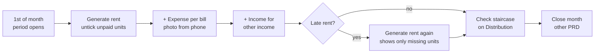
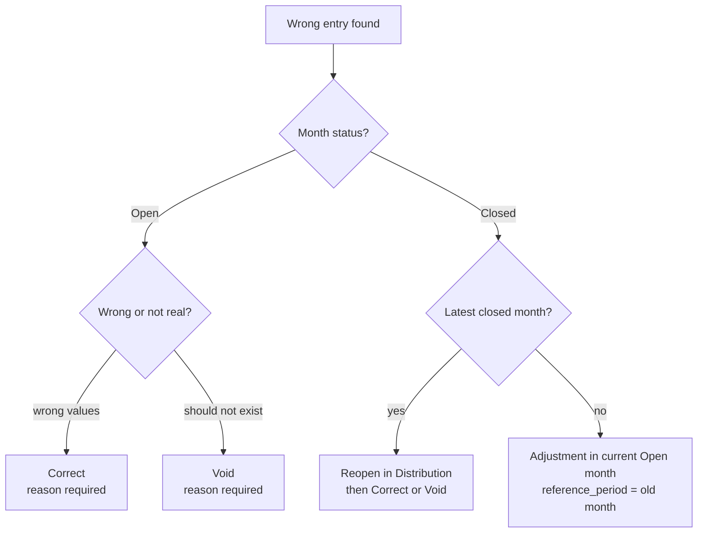

# BariHisab — Income & Expenses PRD

> Version 1.0 · Nov 9, 2026 · Author: Rayhan (dev4@awfatech.com)
> Module: Income & Expenses (screen S3, entry form S4, entry detail, Generate rent, master data it needs)
> Depends on: Authentication & Authorization PRD (roles, `can()`, audit log), Periods (Open / Closed)

## Table of Contents

1. [Overview](#1-overview)
2. [Design Analysis](#2-design-analysis)
3. [Core Concepts & Business Rules](#3-core-concepts--business-rules)
4. [Roles & Permissions](#4-roles--permissions)
5. [User Flows](#5-user-flows)
6. [Screens & UI Specification](#6-screens--ui-specification)
7. [Functional Requirements](#7-functional-requirements)
8. [Validation Rules](#8-validation-rules)
9. [Data Model](#9-data-model)
10. [API Specification](#10-api-specification)
11. [Calculations](#11-calculations)
12. [Audit, Notifications & Integrations](#12-audit-notifications--integrations)
13. [Non-functional Requirements](#13-non-functional-requirements)
14. [Acceptance Criteria & Test Cases](#14-acceptance-criteria--test-cases)
15. [Build Plan](#15-build-plan)
16. [Open Questions](#16-open-questions)

---

## 1. Overview

Income & Expenses is where every taka that enters or leaves the house is recorded against a month. Its totals drive the month's **Distributable** amount, so every owner's share depends on this module being correct, complete and traceable.

**Goal.** The Super Admin records a whole month's rent and bills in under 10 minutes from a phone, every owner can see each entry with its bill photo, and no number in a closed month can change silently.

### In scope

| Area | Phase |
| --- | --- |
| Income entry (Rent, Arrear rent, Other income) | P1 |
| Expense entry with bill/receipt attachments, "Paid from Reserve" | P1 |
| "Generate this month's rent" from unit rents | P1 |
| Income / Expenses list per month: tabs, category filter, totals | P1 |
| Entry detail drawer: fields, attachments, change history | P1 |
| Correct (edit) in Open months, Void with reason, Corrected / Void badges | P1 |
| Closed-month lock + Adjustment / Arrear entries in the Open month | P1 |
| Master data: Units, Fund Accounts, Income/Expense Categories | P1 |
| "Raise an objection" link from an entry (opens Complaint form) | P2 (needs Complaints) |
| Unpaid-rent tracking per unit | P2 |
| Recurring expense templates (guard salary, cleaning) | P2 |
| Search by description / vendor, date-range filter, CSV export | P2 |
| Fund transfers (cash → bank deposit) | P2 |

### Out of scope (other modules)

- Month close / reopen, entitlement calculation, Distribution Board
- Payouts, advances, loans (they share the entry drawer UI but live in the Owner Ledger PRD)
- Requests and Special Grant approval (the Grant **expense** is created by the Requests module, see 3.7)
- Tenant management, security deposits (Phase 3)

### Success metrics

| Metric | Target |
| --- | --- |
| Time to record a normal month (6 rents + 5 bills) | ≤ 10 min on mobile |
| Expense entries with a bill attached | ≥ 90% |
| Edits/voids in Open months with a reason in the audit log | 100% |
| Writes to a Closed month that succeed | 0 (API + DB trigger) |
| Owner objections about "missing" bills per quarter | ≤ 1 |
| Rounding/float errors in totals | 0 (integer paisa only) |

---

## 2. Design Analysis

What the BariHisab design (`BariHisab.dc.html`) already shows for this module, and what it leaves open. Section 3 turns each gap into a decision.

### 2.1 What the design defines

| Element | In the design | Notes |
| --- | --- | --- |
| Page header | Kicker = month label, H1 "Income & expenses", buttons **Generate rent** · **+ Income** · **+ Expense** (primary) | Buttons only for Super Admin and only when the month is Open |
| Month picker | Top bar, prev/next, lock icon on Closed, **Draft** tag on Open | Selected month drives the page (`?period=YYYY-MM`) |
| Locked banner | "{Month} is closed and locked. Corrections go in the open month as an Adjustment, or reopen it from Distribution if it is the latest closed month." | Admin sees the reopen hint; owners don't |
| Tabs | Two big tabs: **Income · N entries · ৳total** and **Expense · N entries · ৳total** | Active tab = ink fill |
| Category chips | "All" + only the categories that have entries this month | Reset to All when switching tab |
| List row | Date · Category + tags (Void, Corrected, From reserve, 📎 count) · description · meta (vendor · fund account) · amount | Newest first; voided rows struck through and grey |
| Footer total | "Total · {Income / Expense / category}" | Excludes voided rows |
| Empty state | "No income added for {Month} yet." + **Generate this month's rent** (income tab, Admin) | Expense: "No expenses recorded for {Month} yet." |
| Entry drawer (S4) | Right drawer 540px: type segment (Income/Expense/Payment/Advance/Loan), Month (Open months only), Category, Amount ৳ (big 28px), Date, Fund account (shows balance), Unit (income), Payee/vendor + "Paid from the Reserve" (expense), Description, attachments box | Save label: "Save income" / "Save expense" / "Save correction" |
| Correction | Same drawer prefilled + "Why the correction? (saved to the audit log)" | Sets **Corrected** badge |
| Detail drawer | Kind kicker, category title, 44px amount, tags (Void · reason, Corrected, Locked month), key–value rows, Bills & receipts, History timeline | Actions: **Correct**, **Void** (Admin + Open), **Raise an objection** (everyone) |
| Void dialog | "Void this entry? It stays visible with a Void mark and stops counting in {Month}. Every owner can see your reason." + required reason | |
| Generate rent dialog | One row per active unit without rent this month: checkbox, unit + tenant, editable amount; Total; **Save rent entries** | "Every active unit already has rent recorded this month." when nothing left |
| Settings › Expense categories | Checkbox to activate/deactivate, English + Bangla name, **System** tag | |
| Dashboard tie-ins | "House this month" staircase (Income − Expense − Reserve − Deficit = Distributable), "Latest activity", close-month reminder listing units that haven't paid rent | Reads this module's totals |

### 2.2 Seed data used by the design

- **Units:** Flat 1A ৳18,000 · 1B ৳18,000 · 2A ৳20,000 · 2B ৳20,000 · 3A ৳22,000 · Shop G1 ৳12,000 (each with a tenant name)
- **Fund accounts:** "Cash — with Rayhan" (CASH), "DBBL savings ·· 4471" (BANK)
- **Income categories:** House rent (RENT, system), Arrear rent (ARREAR, system), Other income
- **Expense categories:** Electricity, Gas, Water, Repairs, Cleaning & maintenance, Guard / salary, Holding tax, Owner special grant (system), Other
- **Typical vendors:** DESCO, Dhaka WASA, Titas Gas, DNCC, Grameenphone Ltd (rooftop lease income)

### 2.3 Gaps found and decisions taken

| # | Gap in the design | Decision in this PRD |
| --- | --- | --- |
| G1 | Correction reason is optional in the prototype (falls back to "Corrected") | **Required**, min 5 characters — disputes need the why |
| G2 | No rule for which fund account a generated rent uses (prototype hard-codes Shop G1 → cash) | Each unit gets a `default_fund_account_id`; Generate rent uses it, editable per row |
| G3 | Arrear rent has no field for the month it belongs to | `reference_period` required for ARREAR and for adjustments |
| G4 | "Owner special grant" appears in the manual category list | Hidden from the manual form; only the Requests module creates it (needs beneficiary + all-owner email) |
| G5 | Date can be any day; period is separate | Allowed (D11: late rent lands in the right month). Warn if date is more than 45 days away from the period |
| G6 | Attachments are counted, not uploaded | Real upload flow: presigned URL, private bucket, ≤ 5 files × 5 MB |
| G7 | Fund balance going negative is not handled | Soft warning in the drawer ("Cash would go to −৳2,300"); not a block |
| G8 | "From Reserve" doesn't check reserve balance | Soft warning when the reserve balance is lower than the amount |
| G9 | No duplicate protection | `Idempotency-Key` on every create; warn if same category + amount + date already exists this month |
| G10 | No search or export | P2: search description/vendor, CSV export of the visible list |
| G11 | Edit of a voided entry | Not allowed. Void is final; record a new entry instead |
| G12 | Unit can be deactivated while it has entries | Allowed; history keeps the unit name; it disappears from Generate rent and the form |

---

## 3. Core Concepts & Business Rules

### 3.1 House transaction

One table holds both income and expenses (`house_transactions.kind = INCOME | EXPENSE`). Amounts are **always positive integer paisa**; the kind gives the direction.

### 3.2 Period vs date

- **Period** (`YYYY-MM`) = the month the money belongs to. It decides which month's distributable it changes.
- **Date** (`txn_date`) = the day the cash actually moved.
- October rent collected on 3 November → period `2026-10`, date `2026-11-03` (only if October is still Open).

### 3.3 Open and Closed months

| Month status | Create | Correct | Void | Shown as |
| --- | --- | --- | --- | --- |
| OPEN | ✓ | ✓ (reason) | ✓ (reason) | **Draft** tag |
| CLOSED | ✗ | ✗ | ✗ | 🔒 Locked banner |

- Several months can be Open at once; the form's Month dropdown lists only Open months, default = latest Open month.
- A new period opens automatically on the 1st of the month (cron) or on the first entry for it.
- Closed-month mistakes:
  - **Latest Closed month** → Admin reopens it from Distribution (other PRD), corrects, closes again.
  - **Older months** → an **Adjustment** entry in the current Open month with `reference_period` = the old month.
  - **Late rent for a Closed month** → category **Arrear rent** in the current Open month with `reference_period`.

### 3.4 Correct vs Void (never delete)

- **Correct**: edit fields of a non-voided entry in an Open month. Saves before → after JSON + reason in the audit log; sets `is_corrected = true` → **Corrected** badge.
- **Void**: marks the entry `voided_at`, `void_reason`, `voided_by`. It stays in the list (struck through, grey, **Void** tag) and stops counting in totals. Void cannot be undone; re-enter it instead.
- No DELETE endpoint exists for financial rows.

### 3.5 Paid from Reserve

- Expense-only checkbox. The expense is **excluded** from that month's Expense total (so it doesn't cut the distributable) and is taken from the Reserve balance instead.
- Shows the **From reserve** tag in the list.
- Example from the seed: July 2026 water pump ৳18,000 paid from Reserve.

### 3.6 Fund accounts

Every entry names the account the money went into or came out of (Cash, Bank, Mobile wallet). Income raises that account's balance; expenses lower it. The drawer shows each account with its current balance.

### 3.7 System categories

| Code | Kind | Rule |
| --- | --- | --- |
| `RENT` | Income | Needs a unit; one non-voided RENT per unit per period (warn on a second) |
| `ARREAR` | Income | Needs a unit and `reference_period` (a Closed month) |
| `OWNER_GRANT` | Expense | Created only by Requests › Disburse; needs `beneficiary_owner_id`; hidden in the manual form |
| `ADJUSTMENT_INC` / `ADJUSTMENT_EXP` | Income / Expense | Needs `reference_period` + reason; used for older-month corrections |

System categories cannot be renamed by code, deactivated or deleted. Admin-made categories can be renamed (both languages) and deactivated; deactivated categories stay on old entries but leave the form.

### 3.8 Money

- Stored as `BIGINT` paisa, `CHECK (amount_paisa > 0)`. No floats anywhere (parse "6,300.50" → 630050).
- Displayed with lakh grouping: `৳1,45,000` in English, `৳১,৪৫,০০০` in Bangla; decimals only when paisa ≠ 0.

---

## 4. Roles & Permissions

| Permission key | Action | Super Admin | Owner |
| --- | --- | --- | --- |
| `transaction.view` | See lists, totals, details, history | ✓ | ✓ |
| `attachment.view` | Open bill/receipt files | ✓ | ✓ |
| `transaction.create` | Add income / expense, Generate rent | ✓ | ✗ |
| `transaction.update` | Correct an entry (Open month) | ✓ | ✗ |
| `transaction.void` | Void an entry (Open month) | ✓ | ✗ |
| `transaction.adjust` | Adjustment / Arrear for a Closed month | ✓ | ✗ |
| `transaction.export` | CSV export (P2) | ✓ | ✓ |
| `category.manage` | Add / rename / deactivate categories | ✓ | ✗ |
| `unit.manage` | Add / edit / deactivate units and rent | ✓ | ✗ |
| `fund.manage` | Add / edit / deactivate fund accounts | ✓ | ✗ |
| `complaint.create` | Raise an objection on an entry (P2) | ✓ | ✓ |

Rules: every write checks `can()` **and** the period status on the server; the UI hides buttons with the same check. Future **Accountant** role = `transaction.create`, `transaction.update`, `transaction.view`, `attachment.view` only (no void, no master data).

---

## 5. User Flows

### 5.1 Monthly cycle (Super Admin, target ≤ 10 min)



### 5.2 Add an expense

1. Admin taps **+ Expense** (or the yellow + on mobile).
2. Drawer opens: type = Expense, Month = latest Open, Date = today, Category = last used (default Electricity), Fund = last used.
3. Enters amount, vendor, description; taps **Add bill / receipt** → camera/file → image compressed → uploaded.
4. Optional **Paid from the Reserve**.
5. Soft warnings (fund would go negative, reserve too low, possible duplicate) show in an alert strip; Admin can still save.
6. **Save expense** → toast "Expense of ৳6,300 added to October 2026"; list and dashboard totals update.

### 5.3 Generate rent

1. Admin taps **Generate rent**.
2. Server returns a draft (not saved): every active unit with no non-voided RENT entry in the current Open month, amount = unit rent, fund = unit default fund.
3. Admin unticks units that haven't paid and edits amounts.
4. **Save rent entries** → all ticked rows saved in **one DB transaction**, one audit row "Generated rent for N units · October 2026".
5. Running it again later shows only the units still missing.

### 5.4 Correct or void



### 5.5 Owner checks a bill

1. Owner opens **Income & expenses**, picks a month, switches to Expense.
2. Taps a row → detail drawer: amount, vendor, fund, who recorded it, bill photos, history ("21 Oct · Rayhan · update · ৳6,030 → ৳6,300 · 'Typo — the DESCO bill reads ৳6,300'").
3. Not convinced → **Raise an objection** → Complaint form prefilled "Question about Electricity · September 2026" with the entry linked (P2).

---

## 6. Screens & UI Specification

All screens follow the BariHisab design system (ink on paper, one yellow signal, 0 radius, 2px rules, 44px targets, Archivo + Hind Siliguri, bilingual).

### 6.1 S3 — Income & expenses list · `/entries?period=2026-10&type=INCOME&category=ALL`

| Zone | Content |
| --- | --- |
| Header | Kicker = month label; H1; Admin + Open month: **Generate rent** (secondary), **+ Income** (secondary), **+ Expense** (primary) |
| Lock banner | Closed month only; surface background, lock icon, text from 2.1 |
| Tabs | Income / Expense, each showing entry count and total; selected = ink fill |
| Chips | All + categories present this month; selected = ink fill |
| List | Rows sorted by date desc, then created_at desc. Row = date (13px muted) · category 600 + tags · description · meta · amount 800 right-aligned |
| Footer | 2px ink top rule; "Total · {label}" and the sum of non-voided rows in the filter |
| Empty | One line + action button (see 2.1) |
| Loading | 6 skeleton rows |
| Mobile (< 860px) | Same order; header buttons move to the yellow + FAB (Expense) and a "⋯" menu (Income, Generate rent); amount stays on the right |

URL holds `period`, `type`, `category` so a link opens the same view.

### 6.2 S4 — Entry drawer (create / correct)

| Field | Income | Expense | Default | Notes |
| --- | --- | --- | --- | --- |
| Type segment | ✓ | ✓ | from button | Hidden when correcting |
| Month (period) | ✓ | ✓ | latest Open month | Only Open months listed |
| Category | ✓ | ✓ | Rent / last used | Active categories of that kind; no OWNER_GRANT |
| Reference month | if ARREAR/ADJ | if ADJ | — | Closed months only |
| Amount (৳) | ✓ | ✓ | empty | 56px input, 28px/800, numeric keypad, accepts `6,300` and Bangla digits |
| Date | ✓ | ✓ | today | Date picker |
| Fund account | ✓ | ✓ | last used / unit default | Each option shows its balance |
| Unit | ✓ (required for RENT/ARREAR) | — | — | "Flat 2A · Dr. Mahbub Alam" |
| Payee / vendor | — | ✓ | — | Autocomplete from previous vendors |
| Paid from the Reserve | — | ✓ | off | Checkbox with help text |
| Description | ✓ | ✓ | — | ≤ 200 chars; auto "Flat 1A · Kamal Uddin" for rent if empty |
| Attachments | ✓ | ✓ | — | Dashed box, camera icon; "JPG, PNG, WebP or PDF · up to 5 files, 5 MB each"; thumbnails with remove ✕ |
| Why the correction? | — | — | — | Correct mode only, required |

Footer: **Save income / Save expense / Save correction** (primary, arrow) + Cancel. Warnings in the red alert strip, errors under each field.

### 6.3 Entry detail drawer

- Kicker = Income / Expense; title = category; amount 44px/800.
- Tags: **Void · {reason}**, **Corrected**, **🔒 Locked month**.
- Rows: Month, Date, Fund account, Unit, Payee/vendor, Description, Paid from Reserve, Beneficiary, Reference month, Recorded by (empty rows hidden).
- **Bills & receipts**: thumbnails; tap an image → in-app lightbox (zoom, download, next/previous) over the drawer; PDFs open in a new tab. Files load from the app's own origin (`/api/v1/attachments/:id/file`), never a storage URL.
- **History**: Created + every update/void from the audit log, newest last, with before → after and reason.
- Footer: Admin + Open + not voided → **Correct** (primary), **Void** (secondary); everyone → **Raise an objection** (P2).

### 6.4 Void dialog

Title "Void this entry?", body from 2.1, required **Reason** textarea (min 5 chars), buttons **Cancel** / **Void entry**.

### 6.5 Generate rent dialog

- Title "Generate rent · {Month}"; body "Drafted from each unit's set rent. Adjust anything, untick units that haven't paid, then save."
- Rows: checkbox · unit name + tenant · amount input (140px) · (P2) fund select.
- Ink rule, **Total** of ticked rows, **Cancel** / **Save rent entries**.
- Empty: "Every active unit already has rent recorded this month." + **Done**.

### 6.6 Settings › Master data

| Section | Fields | Actions |
| --- | --- | --- |
| Units | Name, monthly rent ৳, tenant name, default fund account, active | Add, edit, deactivate |
| Fund accounts | Name, type (Cash/Bank/Wallet), opening balance, opening date, active | Add, edit name, deactivate (only if balance = 0) |
| Income categories | English name, Bangla name, active, System tag | Add, rename, deactivate (not system) |
| Expense categories | Same | Same |

---

## 7. Functional Requirements

| ID | Requirement | Priority |
| --- | --- | --- |
| INC-01 | Create income: period, category, unit, amount, date, fund account, description, attachments | P1 |
| INC-02 | RENT and ARREAR require a unit; ARREAR requires a Closed `reference_period` | P1 |
| INC-03 | Warn (not block) on a second non-voided RENT for the same unit + period | P1 |
| INC-04 | Generate rent: draft for every active unit without RENT in the current Open month; editable; saved in one transaction | P1 |
| INC-05 | Unpaid-rent list per month (units with no RENT); shown on dashboard reminder and as a filter chip | P2 |
| EXP-01 | Create expense: period, category, amount, date, fund account, vendor, description, From Reserve, attachments | P1 |
| EXP-02 | Default expense categories seeded (see 2.2); Admin can add, rename, deactivate | P1 |
| EXP-03 | Vendor autocomplete from this property's previous expenses | P1 |
| EXP-04 | Recurring expense templates (category, vendor, amount, fund, day of month); "Add this month's recurring" button drafts them like Generate rent | P2 |
| EXP-05 | OWNER_GRANT expenses only via Requests › Disburse | P1 |
| LST-01 | List per period with Income/Expense tabs, counts and totals | P1 |
| LST-02 | Category chips showing only categories with entries | P1 |
| LST-03 | Tags: Void, Corrected, From reserve, attachment count | P1 |
| LST-04 | Footer total of the current filter, excluding voided | P1 |
| LST-05 | State in URL (`period`, `type`, `category`) | P1 |
| LST-06 | Search description/vendor, date range filter | P2 |
| LST-07 | CSV export of the current list (bilingual headers, amounts in taka) | P2 |
| DET-01 | Detail drawer with all fields, attachments, history | P1 |
| DET-02 | "Raise an objection" creates a complaint linked to the entry | P2 |
| COR-01 | Correct any field of a non-voided entry in an Open month; reason required; Corrected badge | P1 |
| COR-02 | Changing the period of an entry is allowed only between Open months | P1 |
| VOD-01 | Void with required reason; entry stays visible; excluded from totals | P1 |
| VOD-02 | Voided entries cannot be corrected or un-voided | P1 |
| LCK-01 | No create/update/void in a Closed period — API `409 PERIOD_CLOSED` + DB trigger | P1 |
| LCK-02 | Adjustment entries (income or expense) in the Open month for older months, with `reference_period` + reason | P1 |
| ATT-01 | Upload JPG/PNG/WebP/PDF, max 5 per entry, ≤ 5 MB each; images compressed client-side (max 2000px, ~80% quality) | P1 |
| ATT-02 | Private storage; view through the authenticated same-origin file proxy (permission checked on every request, no storage URL reaches the browser); files cannot be replaced, only added or removed (removal audited) | P1 |
| ATT-03 | Attachments can be added to an entry in an Open month after saving | P1 |
| FND-01 | Fund account balance shown in the form; soft warning if the entry would make it negative | P1 |
| FND-02 | Fund transfer between accounts (not income/expense) | P2 |
| RSV-01 | Soft warning when a From-Reserve expense exceeds the reserve balance | P1 |
| DUP-01 | `Idempotency-Key` on every create; same key → same response | P1 |
| DUP-02 | Soft warning if same kind + category + amount + date already exists in the period | P1 |
| MST-01 | Units CRUD (no delete), default fund per unit | P1 |
| MST-02 | Fund accounts CRUD (no delete; deactivate only at zero balance) | P1 |
| MST-03 | Categories CRUD (no delete; system ones locked) | P1 |
| PER-01 | Auto-open the new period on the 1st (Asia/Dhaka) or on first entry | P1 |
| AUD-01 | Every create, update, void, generate, attachment add/remove, master-data change → audit log | P1 |
| I18N-01 | All labels, categories (name_en/name_bn), messages and numbers in Bangla and English | P1 |

---

## 8. Validation Rules

| Field | Rule | Error message (en) |
| --- | --- | --- |
| period | Exists, status OPEN, same property | "That month is closed. Record an Adjustment in the open month instead." |
| kind | INCOME or EXPENSE | — |
| category_id | Active, same kind, not OWNER_GRANT (manual) | "Pick a category." |
| amount | Integer paisa > 0, ≤ ৳1,00,00,000 (1 crore) | "Enter an amount greater than zero." |
| txn_date | Valid date, not in the future by more than 1 day | "Date can't be in the future." |
| txn_date vs period | Warn if more than 45 days from the period month | Warning: "Date is far from the selected month — check the month." |
| fund_account_id | Active account, same property | "Pick a fund account." |
| unit_id | Required for RENT/ARREAR; active unit | "Pick the unit this rent is for." |
| reference_period | Required for ARREAR/ADJUSTMENT; must be a CLOSED month before `period` | "Pick the closed month this belongs to." |
| vendor | ≤ 100 chars | — |
| description | ≤ 200 chars | — |
| from_reserve | Only with kind EXPENSE | — |
| reason (correct/void/adjust) | Required, 5–500 chars | "Write a short reason — every owner can see it." |
| attachments | ≤ 5, each ≤ 5 MB, MIME in jpg/png/webp/pdf (checked by magic bytes too) | "Only JPG, PNG, WebP or PDF up to 5 MB." |

Amount parsing: strip `৳`, spaces and commas, convert Bangla digits `০–৯` to `0–9`, allow max 2 decimals, convert to paisa with integer math.

---

## 9. Data Model

PostgreSQL 16. Every table has `id uuid`, `property_id`, `created_at`, `updated_at`. All FKs `ON DELETE RESTRICT`.

### 9.1 Tables

```sql
CREATE TABLE units (
  id uuid PRIMARY KEY DEFAULT gen_random_uuid(),
  property_id uuid NOT NULL REFERENCES properties(id),
  name text NOT NULL,                       -- "Flat 2A"
  tenant_name text,                         -- "Dr. Mahbub Alam"
  default_rent_paisa bigint NOT NULL DEFAULT 0 CHECK (default_rent_paisa >= 0),
  default_fund_account_id uuid REFERENCES fund_accounts(id),
  sort_order int NOT NULL DEFAULT 0,
  is_active boolean NOT NULL DEFAULT true,
  created_at timestamptz NOT NULL DEFAULT now(),
  updated_at timestamptz NOT NULL DEFAULT now(),
  UNIQUE (property_id, name)
);

CREATE TABLE fund_accounts (
  id uuid PRIMARY KEY DEFAULT gen_random_uuid(),
  property_id uuid NOT NULL REFERENCES properties(id),
  name text NOT NULL,                       -- "DBBL savings ·· 4471"
  type text NOT NULL CHECK (type IN ('CASH','BANK','WALLET')),
  opening_balance_paisa bigint NOT NULL DEFAULT 0,
  opening_date date NOT NULL,
  is_active boolean NOT NULL DEFAULT true,
  created_at timestamptz NOT NULL DEFAULT now(),
  updated_at timestamptz NOT NULL DEFAULT now()
);

CREATE TABLE categories (
  id uuid PRIMARY KEY DEFAULT gen_random_uuid(),
  property_id uuid NOT NULL REFERENCES properties(id),
  kind text NOT NULL CHECK (kind IN ('INCOME','EXPENSE')),
  code text NOT NULL,                       -- RENT, ARREAR, ELEC, OWNER_GRANT ...
  name_en text NOT NULL,
  name_bn text NOT NULL,
  is_system boolean NOT NULL DEFAULT false,
  is_active boolean NOT NULL DEFAULT true,
  sort_order int NOT NULL DEFAULT 0,
  created_at timestamptz NOT NULL DEFAULT now(),
  updated_at timestamptz NOT NULL DEFAULT now(),
  UNIQUE (property_id, code)
);

CREATE TABLE house_transactions (
  id uuid PRIMARY KEY DEFAULT gen_random_uuid(),
  property_id uuid NOT NULL REFERENCES properties(id),
  period_id uuid NOT NULL REFERENCES periods(id),
  kind text NOT NULL CHECK (kind IN ('INCOME','EXPENSE')),
  category_id uuid NOT NULL REFERENCES categories(id),
  unit_id uuid REFERENCES units(id),
  amount_paisa bigint NOT NULL CHECK (amount_paisa > 0),
  txn_date date NOT NULL,
  fund_account_id uuid NOT NULL REFERENCES fund_accounts(id),
  vendor text,
  description text,
  from_reserve boolean NOT NULL DEFAULT false,
  reference_period_id uuid REFERENCES periods(id),
  beneficiary_owner_id uuid REFERENCES owners(id),
  request_id uuid REFERENCES money_requests(id),
  source text NOT NULL DEFAULT 'MANUAL'
        CHECK (source IN ('MANUAL','GENERATED_RENT','RECURRING','REQUEST','ADJUSTMENT')),
  is_corrected boolean NOT NULL DEFAULT false,
  voided_at timestamptz,
  voided_by uuid REFERENCES users(id),
  void_reason text,
  created_by uuid NOT NULL REFERENCES users(id),
  updated_by uuid REFERENCES users(id),
  idempotency_key text,
  created_at timestamptz NOT NULL DEFAULT now(),
  updated_at timestamptz NOT NULL DEFAULT now(),
  CHECK (NOT from_reserve OR kind = 'EXPENSE'),
  CHECK ((voided_at IS NULL) = (void_reason IS NULL)),
  UNIQUE (property_id, idempotency_key)
);

CREATE TABLE attachments (
  id uuid PRIMARY KEY DEFAULT gen_random_uuid(),
  property_id uuid NOT NULL REFERENCES properties(id),
  entity_type text NOT NULL,                -- 'house_transaction'
  entity_id uuid NOT NULL,
  storage_key text NOT NULL,
  file_name text NOT NULL,
  mime text NOT NULL CHECK (mime IN ('image/jpeg','image/png','image/webp','application/pdf')),
  size_bytes int NOT NULL CHECK (size_bytes <= 5242880),
  uploaded_by uuid NOT NULL REFERENCES users(id),
  removed_at timestamptz,
  removed_by uuid REFERENCES users(id),
  created_at timestamptz NOT NULL DEFAULT now()
);

-- P2
CREATE TABLE recurring_expense_templates (
  id uuid PRIMARY KEY DEFAULT gen_random_uuid(),
  property_id uuid NOT NULL REFERENCES properties(id),
  category_id uuid NOT NULL REFERENCES categories(id),
  vendor text, description text,
  amount_paisa bigint NOT NULL CHECK (amount_paisa > 0),
  fund_account_id uuid NOT NULL REFERENCES fund_accounts(id),
  day_of_month int NOT NULL CHECK (day_of_month BETWEEN 1 AND 28),
  is_active boolean NOT NULL DEFAULT true,
  created_at timestamptz NOT NULL DEFAULT now(),
  updated_at timestamptz NOT NULL DEFAULT now()
);

-- P2
CREATE TABLE fund_transfers (
  id uuid PRIMARY KEY DEFAULT gen_random_uuid(),
  property_id uuid NOT NULL REFERENCES properties(id),
  from_account_id uuid NOT NULL REFERENCES fund_accounts(id),
  to_account_id uuid NOT NULL REFERENCES fund_accounts(id),
  amount_paisa bigint NOT NULL CHECK (amount_paisa > 0),
  transfer_date date NOT NULL,
  note text,
  voided_at timestamptz, void_reason text,
  created_by uuid NOT NULL REFERENCES users(id),
  created_at timestamptz NOT NULL DEFAULT now(),
  CHECK (from_account_id <> to_account_id)
);
```

### 9.2 Indexes

```sql
CREATE INDEX ht_period_kind   ON house_transactions (property_id, period_id, kind) WHERE voided_at IS NULL;
CREATE INDEX ht_category      ON house_transactions (period_id, category_id);
CREATE INDEX ht_unit_period   ON house_transactions (unit_id, period_id) WHERE voided_at IS NULL;
CREATE INDEX ht_fund          ON house_transactions (fund_account_id) WHERE voided_at IS NULL;
CREATE INDEX ht_vendor_trgm   ON house_transactions USING gin (vendor gin_trgm_ops);   -- P2 search
CREATE INDEX att_entity       ON attachments (entity_type, entity_id) WHERE removed_at IS NULL;
```

### 9.3 Closed-period guard (DB trigger)

```sql
CREATE FUNCTION block_closed_period() RETURNS trigger AS $$
BEGIN
  IF (SELECT status FROM periods WHERE id = COALESCE(NEW.period_id, OLD.period_id)) = 'CLOSED' THEN
    RAISE EXCEPTION 'PERIOD_CLOSED';
  END IF;
  IF TG_OP = 'UPDATE' AND OLD.period_id <> NEW.period_id
     AND (SELECT status FROM periods WHERE id = OLD.period_id) = 'CLOSED' THEN
    RAISE EXCEPTION 'PERIOD_CLOSED';
  END IF;
  RETURN NEW;
END $$ LANGUAGE plpgsql;

CREATE TRIGGER ht_closed_guard BEFORE INSERT OR UPDATE ON house_transactions
FOR EACH ROW EXECUTE FUNCTION block_closed_period();

REVOKE DELETE ON house_transactions, attachments FROM app_user;
```

### 9.4 Views

```sql
CREATE VIEW v_period_totals AS
SELECT period_id,
  SUM(amount_paisa) FILTER (WHERE kind='INCOME')                       AS income_paisa,
  SUM(amount_paisa) FILTER (WHERE kind='EXPENSE' AND NOT from_reserve) AS expense_paisa,
  SUM(amount_paisa) FILTER (WHERE kind='EXPENSE' AND from_reserve)     AS reserve_spent_paisa,
  COUNT(*) FILTER (WHERE kind='INCOME')                                AS income_count,
  COUNT(*) FILTER (WHERE kind='EXPENSE')                               AS expense_count
FROM house_transactions
WHERE voided_at IS NULL
GROUP BY period_id;

CREATE VIEW v_unpaid_rent AS            -- P2
SELECT p.id AS period_id, u.id AS unit_id, u.name, u.tenant_name, u.default_rent_paisa
FROM periods p
JOIN units u ON u.property_id = p.property_id AND u.is_active
WHERE NOT EXISTS (
  SELECT 1 FROM house_transactions t JOIN categories c ON c.id = t.category_id
  WHERE t.period_id = p.id AND t.unit_id = u.id AND c.code = 'RENT' AND t.voided_at IS NULL);
```

---

## 10. API Specification

REST under `/api/v1`, JSON, cookie session + `X-CSRF-Token`. Money = integer paisa; dates ISO; periods `YYYY-MM`. Error shape `{ "error": { "code", "message", "details" } }`. Every POST that creates money rows needs `Idempotency-Key`.

### 10.1 Endpoints

| Method | Path | Permission | Purpose |
| --- | --- | --- | --- |
| GET | `/transactions?period=2026-10&kind=EXPENSE&category=ELEC&q=&cursor=&limit=50` | `transaction.view` | List + totals |
| GET | `/transactions/summary?period=2026-10` | `transaction.view` | Tab counts and totals, category chips |
| GET | `/transactions/:id` | `transaction.view` | Detail + attachments + history |
| POST | `/transactions` | `transaction.create` | Create income/expense |
| PATCH | `/transactions/:id` | `transaction.update` | Correct (needs `reason`) |
| POST | `/transactions/:id/void` | `transaction.void` | Void (needs `reason`) |
| POST | `/transactions/adjustments` | `transaction.adjust` | Adjustment for a Closed month |
| POST | `/transactions/generate-rent/preview` | `transaction.create` | Draft rows, nothing saved |
| POST | `/transactions/generate-rent` | `transaction.create` | Save ticked rows in one transaction |
| GET | `/transactions/export.csv?period=&kind=` | `transaction.export` | CSV (P2) |
| GET | `/transactions/vendors?q=` | `transaction.create` | Vendor autocomplete |
| POST | `/attachments/presign` | `transaction.create` | Get upload URL `{ fileName, mime, size }` |
| POST | `/transactions/:id/attachments` | `transaction.update` | Link uploaded files |
| DELETE | `/transactions/:id/attachments/:attId` | `transaction.update` | Soft-remove (Open month, audited) |
| GET | `/attachments/:id` | `attachment.view` | `{ url, mime, fileName }` — `url` is the same-origin file path |
| GET | `/attachments/:id/file` | `attachment.view` | Streams the file from the private bucket (same-origin proxy; ETag / 304) |
| GET / POST / PATCH | `/units`, `/units/:id` | read: view · write: `unit.manage` | Units |
| GET / POST / PATCH | `/fund-accounts`, `/fund-accounts/:id` | read: view · write: `fund.manage` | Fund accounts + live balance |
| GET / POST / PATCH | `/categories?kind=`, `/categories/:id` | read: view · write: `category.manage` | Categories |
| GET / POST / PATCH | `/recurring-expenses` | `transaction.create` | Templates (P2) |
| GET / POST | `/fund-transfers` | `fund.manage` | Transfers (P2) |

### 10.2 Create an expense

```http
POST /api/v1/transactions
Idempotency-Key: 9b2f6c1e-7a1d-4c55-9e0b-3f8f2d1a7c42
Content-Type: application/json

{
  "period": "2026-10",
  "kind": "EXPENSE",
  "category_id": "cat_elec",
  "amount_paisa": 630000,
  "txn_date": "2026-10-12",
  "fund_account_id": "fa_bank",
  "vendor": "DESCO",
  "description": "Common meter · stairs, pump, gate",
  "from_reserve": false,
  "attachment_ids": ["att_81f2"]
}
```

```json
201 Created
{
  "transaction": { "id": "tx_5d1", "period": "2026-10", "kind": "EXPENSE", "amount_paisa": 630000, "is_corrected": false },
  "warnings": [],
  "period_totals": { "income_paisa": 11300000, "expense_paisa": 1398000, "reserve_spent_paisa": 0 }
}
```

### 10.3 Correct an entry

```http
PATCH /api/v1/transactions/tx_5d1
{ "amount_paisa": 630000, "reason": "Typo — the DESCO bill reads ৳6,300" }
```

`200` → updated entry; audit row with `before: { amount_paisa: 603000 }`, `after: { amount_paisa: 630000 }`.

### 10.4 Generate rent

```http
POST /api/v1/transactions/generate-rent/preview
{ "period": "2026-10" }
```

```json
200 OK
{ "period": "2026-10",
  "rows": [
    { "unit_id": "u_3a", "unit": "Flat 3A", "tenant": "Nusrat Jahan", "amount_paisa": 2200000, "fund_account_id": "fa_bank", "selected": true }
  ] }
```

```http
POST /api/v1/transactions/generate-rent
Idempotency-Key: ...
{ "period": "2026-10", "txn_date": "2026-10-22",
  "rows": [ { "unit_id": "u_3a", "amount_paisa": 2200000, "fund_account_id": "fa_bank" } ] }
```

`201` → `{ "created": 1, "transactions": [...] }`. A unit that already got rent since the preview → that row skipped and listed in `skipped`.

### 10.5 Error codes

| HTTP | Code | When |
| --- | --- | --- |
| 403 | `FORBIDDEN` | Missing permission |
| 404 | `NOT_FOUND` | Entry not in this property |
| 409 | `PERIOD_CLOSED` | Write to a Closed month |
| 409 | `ALREADY_VOIDED` | Correct or void a voided entry |
| 409 | `IDEMPOTENCY_CONFLICT` | Same key, different body |
| 409 | `CATEGORY_LOCKED` | Rename/deactivate a system category |
| 409 | `FUND_NOT_EMPTY` | Deactivate a fund account with balance ≠ 0 |
| 413 | `FILE_TOO_LARGE` | Attachment > 5 MB |
| 422 | `VALIDATION_FAILED` | Field errors in `details.fields` |
| 422 | `TOO_MANY_ATTACHMENTS` | More than 5 files |

Warnings (never block) come back in `warnings[]`: `FUND_NEGATIVE`, `RESERVE_LOW`, `POSSIBLE_DUPLICATE`, `RENT_ALREADY_RECORDED`, `DATE_FAR_FROM_PERIOD`.

---

## 11. Calculations

This module produces three numbers per month that the Distribution module consumes:

```text
Income(P)        = Σ amount of non-voided INCOME in P
Expense(P)       = Σ amount of non-voided EXPENSE in P where from_reserve = false
ReserveSpent(P)  = Σ amount of non-voided EXPENSE in P where from_reserve = true
```

Then (owned by Distribution, shown on the S3/Home staircase):

```text
Base(P)          = Income(P) − Expense(P)
Reserve(P)       = rule(Base) if Base > 0 else 0        -- fixed or % (seed: 5%)
Net(P)           = Base(P) − Reserve(P) − DeficitCarried(P−1)
Distributable(P) = max(0, Net(P))
```

Fund account balance:

```text
Balance(a) = opening(a) + Σ INCOME(a) − Σ EXPENSE(a) ± transfers(a) ± owner-ledger cash moves(a) ± loan cash moves(a)
```

Worked example (seed, October 2026 so far):

| Item | Amount |
| --- | --- |
| Rent 5 units (3A unpaid) + Shop G1 | ৳88,000 |
| Rooftop tower lease | ৳15,000 |
| **Income** | **৳1,03,000** |
| Electricity ৳6,300 + Water ৳3,600 + Gas ৳1,080 + Cleaning ৳3,000 | ৳13,980 |
| **Expense** | **৳13,980** |
| Base | ৳89,020 |

---

## 12. Audit, Notifications & Integrations

### 12.1 Audit actions

| Action | Entity | before / after |
| --- | --- | --- |
| `transaction.created` | Income / Expense | after = full row |
| `transaction.updated` | Income / Expense | changed fields only + reason |
| `transaction.voided` | Income / Expense | reason |
| `transaction.rent_generated` | Period | unit list + total |
| `transaction.adjustment_created` | Income / Expense | reference period + reason |
| `attachment.added` / `attachment.removed` | Attachment | file name |
| `unit.*`, `fund_account.*`, `category.*` | Master data | changed fields |

All are financial (`fin = true`) so owners see them in the Audit Log.

### 12.2 Notifications

| Event | Who | Phase |
| --- | --- | --- |
| Entry voided or corrected in a month older than 7 days | All owners (daily digest) | P2 |
| Expense ≥ ৳50,000 (configurable) | All owners | P2 |
| Month-close reminder listing unpaid rent units | Super Admin | P2 |
| Monthly report (income/expense summary, top 3 expenses) | All owners | P2 (Reports PRD) |

### 12.3 Other modules that read this data

- **Home dashboard**: "House this month" staircase, Latest activity, unpaid-rent reminder.
- **Distribution**: Income, Expense, ReserveSpent per period; Close locks this module's rows.
- **Reports**: monthly expense by category, yearly income/expense chart.
- **Complaints**: entry link from "Raise an objection".
- **Reconciliation**: fund balances.

---

## 13. Non-functional Requirements

| Area | Requirement |
| --- | --- |
| Correctness | Integer paisa only; all writes in one DB transaction with the audit row; trigger blocks Closed periods |
| Concurrency | `SELECT … FOR SHARE` on the period row during create/update so a Close can't run mid-write |
| Performance | List of a month (≤ 200 rows) p95 < 300 ms; summary < 100 ms; form opens < 200 ms |
| Mobile | Usable at 360px; numeric keypad on amount; camera capture on attachments; drawer is full screen under 560px |
| Files | Private bucket (S3 / R2), presigned 5-min upload URLs, viewing via the authenticated same-origin proxy (nosniff, script-free CSP), magic-byte MIME check, EXIF GPS stripped |
| Offline | Not in v1; form keeps a draft in memory if the request fails, with a Retry button |
| Localization | Category names in both languages; Bangla digits and month names; lakh grouping |
| Accessibility | Labels on every field, errors linked by `aria-describedby`, tabs are real buttons with `aria-pressed`, rows are buttons |
| Security | `can()` + property scope on every query; owners never get write endpoints; vendor/description escaped on output |
| Observability | Log `PERIOD_CLOSED`, idempotency replays and upload failures with request id |

---

## 14. Acceptance Criteria & Test Cases

### 14.1 Acceptance criteria

- [ ] Admin adds an expense with a bill photo on a phone in under 60 seconds
- [ ] Generate rent drafts only units without rent; saving 5 rows creates 5 entries and 1 audit row
- [ ] Running Generate rent again shows only the remaining unit(s)
- [ ] Tabs show correct counts and totals; voided rows are struck through and excluded
- [ ] Category chips only show categories used this month
- [ ] Correction without a reason is rejected; with a reason it shows **Corrected** and history before → after
- [ ] Void requires a reason; the entry stays visible with **Void · reason**
- [ ] Any write to a Closed month returns `409 PERIOD_CLOSED`; a direct SQL UPDATE also fails
- [ ] Closed month shows the lock banner and no create/edit buttons
- [ ] ARREAR needs a unit and a Closed reference month
- [ ] From-Reserve expense doesn't change the month's Expense total
- [ ] Owner sees everything read-only and gets `403` on every write endpoint
- [ ] Attachments over 5 MB or of another type are refused; a 6th file is refused
- [ ] Double-tapping Save creates one entry (idempotency)
- [ ] All screens work in বাংলা and English at 360px

### 14.2 Test cases

| ID | Scenario | Input | Expected |
| --- | --- | --- | --- |
| IE-01 | Create income | RENT, Flat 1A, ৳18,000, Oct | 201; Income total +1,800,000 paisa |
| IE-02 | Amount parsing | "৳১৮,০০০.৫০" | 1,800,050 paisa |
| IE-03 | Zero amount | 0 | 422 `VALIDATION_FAILED` |
| IE-04 | Closed month | Create in Sep (Closed) | 409 `PERIOD_CLOSED` |
| IE-05 | Correct | ৳6,030 → ৳6,300, reason | 200; `is_corrected`; audit before/after |
| IE-06 | Correct without reason | — | 422 |
| IE-07 | Void | reason "Duplicate entry" | Excluded from totals; visible with tag |
| IE-08 | Correct a voided entry | — | 409 `ALREADY_VOIDED` |
| IE-09 | Generate rent | 6 units, 3A already paid | Preview 5 rows |
| IE-10 | Generate rent race | Unit paid between preview and save | Row in `skipped`, others saved |
| IE-11 | From reserve | ৳18,000 pump, from_reserve | Expense unchanged; ReserveSpent ৳18,000 |
| IE-12 | Second rent same unit | RENT 1A twice in Oct | Saved with warning `RENT_ALREADY_RECORDED` |
| IE-13 | Arrear | ARREAR 3A ৳22,000 in Nov, ref Oct (Closed) | Counts in Nov income |
| IE-14 | Idempotency | Same key twice | One row; same response |
| IE-15 | Owner write | Owner `POST /transactions` | 403 |
| IE-16 | System category | Deactivate RENT | 409 `CATEGORY_LOCKED` |
| IE-17 | Fund negative | Cash ৳2,000, expense ৳5,000 cash | Saved with `FUND_NEGATIVE` warning |
| IE-18 | Move period | Change Oct → Nov (both Open) | Allowed; both month totals update |
| IE-19 | Move into Closed | Change Oct → Sep (Closed) | 409 |
| IE-20 | Attachment type | .exe renamed .jpg | 422 (magic bytes) |

---

## 15. Build Plan

Estimate for one full-time developer: about 2 weeks for P1.

| Day | Work |
| --- | --- |
| 1 | Migrations (units, fund_accounts, categories, house_transactions, attachments), trigger, views, seed categories |
| 2 | `money` utils (parse/format, Bangla digits, lakh grouping) + unit tests; master-data APIs |
| 3 | `POST/PATCH/void /transactions` with `can()`, period checks, idempotency, audit |
| 4 | List + summary APIs; S3 list screen (tabs, chips, rows, total, empty, lock banner) |
| 5 | S4 entry drawer (create + correct), validation, warnings |
| 6 | Attachments: presign, upload, compress, proxied view + lightbox, thumbnails |
| 7 | Detail drawer with history; Void dialog |
| 8 | Generate rent preview + save + dialog |
| 9 | Settings › Units, Fund accounts, Categories screens |
| 10 | Adjustments/Arrear, i18n pass, mobile pass, integration tests (IE-01…IE-20), staging check |

P2 (≈ 1 week): unpaid-rent tracking, recurring templates, search/date filter, CSV export, fund transfers, objection link, notifications.

---

## 16. Open Questions

- [ ] Should the correction reason be required for every edit (this PRD) or only for amount changes?
- [ ] Rent amounts in whole taka only, or allow paisa?
- [ ] Should a big expense (e.g. ≥ ৳50,000) need a second owner's approval before it counts?
- [ ] Will tenants pay partial rent? If yes, allow several RENT entries per unit per month without a warning.
- [ ] Should owners see vendor phone numbers / bill images of all months, or only the last 12?
- [ ] Is the rooftop tower lease monthly income, or yearly income spread over 12 months?
- [ ] Do we need a separate "Bank charge" / "Service charge" category for bKash/Nagad fees?